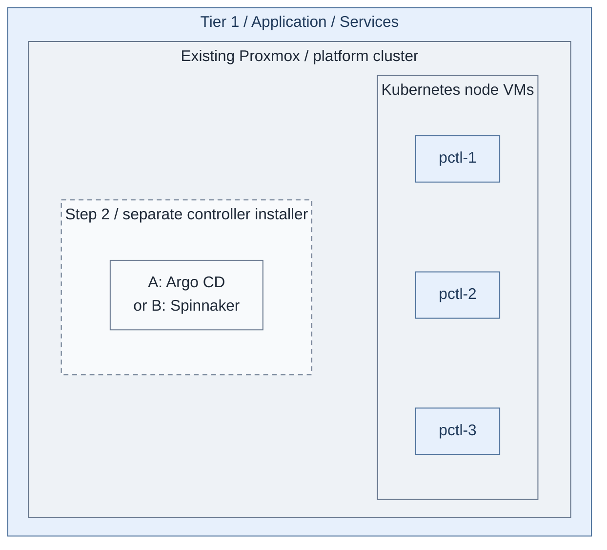

# Stage 7: Delivery

Establish Tier 1 application delivery. Tier 0 already uses Flux from
[Stage 4](../stage-4-kubernetes/README.md); select **A: Argo CD** or **B: Spinnaker**
for Tier 1. GitLab and CI handover belong to [Stage 9](../stage-9-development/README.md).

**Prerequisites:** accepted Secrets, approved images, independent bootstrap Git/OCI
sources and [cluster-foundation gates](../stage-4-kubernetes/procedures/kubernetes.md#cluster-foundation).
The temporary source must work before GitLab exists.
**Working repositories:** `<prefix>-tier-1` for delivery and registry;
`<prefix>-tier-2` for optional public edge. Tier 0 owns its existing Flux.
**Execution context:** `<prefix>-tier-1/`.

**Automation:** cluster lifecycle, native Argo CD/Spinnaker and Harbor installers are supplied.
They have separate installation commands below; TLS/backup commissioning and live acceptance remain explicit.
See [coverage](../../reference/implementation-support.md#stage-coverage) for live acceptance boundaries.
**Design:** [controller patterns](../../architecture/software/controllers.md).

## Main path

1. [Create the platform runtime](#step-1-create-the-platform-runtime)
2. [Select and qualify delivery](#step-2-select-and-qualify-delivery)
3. [Connect approved artifact supply](#step-3-connect-approved-artifact-supply)

<a id="step-1-deploy-shared-delivery-services"></a>

## Step 1: Create the platform runtime

1. Complete the [Tier 1 cluster procedure](procedures/platform-cluster.md): initialize
   `terraform/deployments/kubernetes/terraform.tfvars`, edit Tier 1 node/IP/endpoint inputs,
   then use the dedicated cluster script's plan/apply/bootstrap sequence.
2. Install and accept the [basic cluster platform](../stage-4-kubernetes/procedures/basic-platform.md)
   from **Tier 1**, using Tier 1's kubeconfig and `ansible/group_vars/cluster_platform.yml`.
3. Verify CNI, persistent storage, private ingress, logging and recovery before Step 2.

An `init` command alone does not create or bootstrap the cluster. Keep the original
cluster secrets and state; an accepted existing Tier 1 cluster can satisfy this step.



**IaC:** Tier 1 [node inputs](../../../tier-1/terraform/deployments/kubernetes/terraform.tfvars.example)
and [cluster command](../../../tier-1/scripts/kubernetes-cluster.sh) create the three
starter VMs. The dashed controller is installed separately in Step 2 through the
[delivery recipe](../../../tier-1/ansible/playbooks/deployment/delivery-platform.yml).

**Result:** an accepted Tier 1 runtime, before application delivery is enabled.

## Step 2: Select and qualify delivery

| Step | Procedure | Authority |
| --- | --- | --- |
| 2a: Argo CD | [Install application GitOps](step-2a-argocd.md), Steps 1–3 | Approved Tier 1 applications; additional targets require a separate reviewed account |
| 2b: Spinnaker | [Install release pipelines](step-2b-spinnaker.md), Steps 1–4 | Approved releases and selected destinations |

Choose **one** branch and complete its input, Secret, install and acceptance steps;
both return here for Step 3. Existing Tier 0 Flux remains unchanged.
Neither Tier 1 controller receives Tier 0 Kubernetes or Proxmox credentials.
Retain the bootstrap source until Stage 9 GitLab source migration is accepted.

Both branches use `ansible/group_vars/delivery_platform.yml`. Create it once:

Run from **`<prefix>-tier-1/`**.

```bash
cp -n ansible/group_vars/delivery_platform.yml.example ansible/group_vars/delivery_platform.yml
```

Edit in **`<prefix>-tier-1/`**.

- `ansible/group_vars/delivery_platform.yml`: Selected delivery controller, cluster context, SSO, storage
  and egress inputs.

Set `delivery_platform_controller` to `argocd` (2a) or `spinnaker` (2b), and
`delivery_platform_install_harbor: false` for this pass. Edit the selected branch's
host, kubeconfig/context, IdP, destination and TLS/backup fields before rendering:

Run from **`<prefix>-tier-1/`**.

```bash
ANSIBLE_CONFIG=ansible/ansible.cfg ansible-playbook -i localhost, ansible/playbooks/deployment/delivery-platform.yml -e @ansible/group_vars/delivery_platform.yml
```

Review the private render. Spinnaker additionally requires its reviewed checksum and
commissioned certificate/backup inputs before apply. With pre-existing Secrets:

Run from **`<prefix>-tier-1/`**.

```bash
ANSIBLE_CONFIG=ansible/ansible.cfg ansible-playbook -i localhost, ansible/playbooks/deployment/delivery-platform.yml -e @ansible/group_vars/delivery_platform.yml -e delivery_platform_action=apply
```

For encrypted bootstrap ownership, add
`-e @secrets/delivery-platform.yml --ask-vault-pass` to both commands; create/edit that
file using [installer Step 1](procedures/delivery-installer.md#inputs-and-secrets).

**Result:** one selected controller with scoped destinations, SSO and recovery.

## Step 3: Connect approved artifact supply

1. Complete [Harbor installation](procedures/registry.md#install-harbor): edit its
   host/storage fields, prepare its Secrets, render and install through the same Tier 1 recipe.
   An accepted existing registry can replace this installation.
2. Verify authorized/denied push and pull, promotion and a clean-target restore.
3. Only for public application endpoints, take the [Tier 2 edge branch](procedures/edge-proxy.md),
   then return here. Private controller APIs do not require public edge publication.

Harbor extends [early software intake](../stage-1-software-intake/README.md#extend-the-capability-later);
it does not deploy another ordinary proxy/cache.

**Result:** verified artifact interfaces extend software intake without a bootstrap dependency.

## Capability available

Tier 1 has a selected delivery path and accepted artifact interfaces.
Continue with [Stage 8: Observability](../stage-8-observability/README.md), then
[Stage 9: Development platform](../stage-9-development/README.md).

<a id="step-2-enable-protected-execution"></a>

Runner installation and bootstrap handover now belong to
[Stage 9, Step 4](../stage-9-development/README.md#step-4-hand-over-infrastructure-execution),
after GitLab and Vault CI authentication exist. This stage does not transfer Tier 0 execution.

<a id="step-3-deploy-shared-investigation"></a>
<a id="step-3-deploy-observability"></a>
