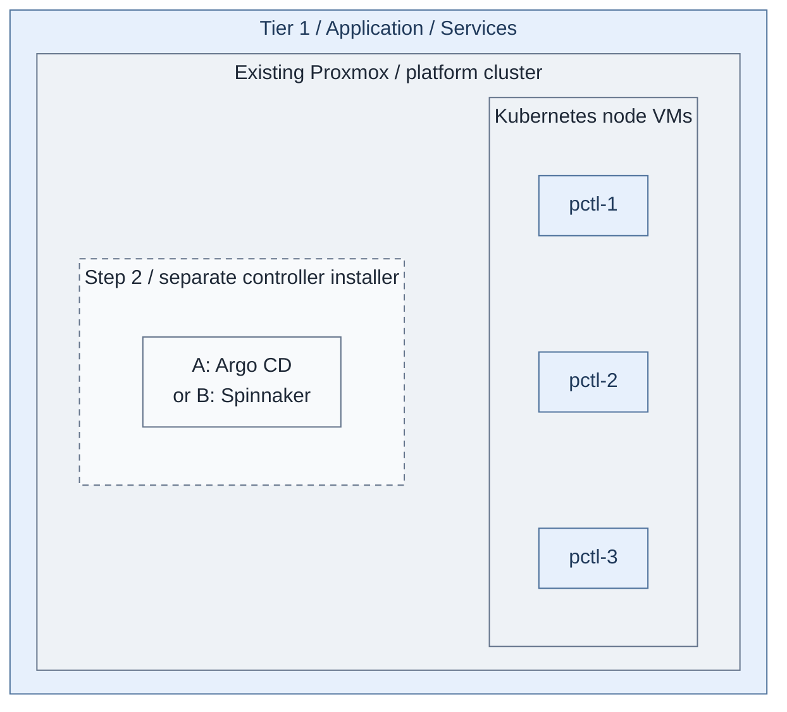

# Stage 7: Delivery

Establish Tier 1 application delivery. Tier 0 already uses Flux from
[Stage 4](../stage-4-kubernetes/README.md); select **A: Argo CD** or **B: Spinnaker**
for Tier 1. GitLab and CI handover belong to [Stage 9](../stage-9-development/README.md).

**Prerequisites:** accepted Tier 0 Kubernetes, Identity and Secrets; approved images,
independent bootstrap Git/OCI sources, private DNS/TLS and qualified storage.
Step 1 creates or accepts Tier 1's cluster and its
[foundation gates](../stage-4-kubernetes/procedures/kubernetes.md#cluster-foundation).
The temporary source must work before GitLab or the new registry exists.
**Working repositories:** `<prefix>-tier-1` for delivery and registry;
`<prefix>-tier-2` for optional public edge. Tier 0 owns its existing Flux.
**Execution context:** `<prefix>-tier-1/`.

**Automation:** cluster lifecycle, native Argo CD/Spinnaker and Harbor installers are supplied.
They have separate installation commands below; TLS/backup commissioning and live acceptance remain explicit.
See [coverage](../../reference/implementation-support.md#stage-coverage) for live acceptance boundaries.
**Design:** [controller patterns](../../architecture/software/controllers.md).

## Main path

1. [Create the platform runtime](#step-1-create-the-platform-runtime)
2. [Select and qualify delivery](#step-2-select-and-qualify-delivery)
3. [Connect approved artifact supply](#step-3-connect-approved-artifact-supply)

## Step 1: Create the platform runtime

1. In **`<prefix>-tier-1/`**, complete the [platform-cluster procedure](procedures/platform-cluster.md)
   through cluster creation, credential export and basic-platform installation. It contains the
   saved-plan commands and the add-on commands; run each installation once.
2. Verify CNI, persistent storage, private ingress, logging, physical placement and recovery.
   An existing cluster can satisfy this step after the same checks; do not bootstrap it again.
3. Keep the accepted Tier 1 kubeconfig/context available for Step 2, with no Tier 0 credentials.

An `init` command alone does not create or bootstrap the cluster. Keep the original
cluster secrets and state; an accepted existing Tier 1 cluster can satisfy this step.

**IaC:** Tier 1 [node inputs](../../../tier-1/terraform/deployments/kubernetes/terraform.tfvars.example)
and [cluster command](../../../tier-1/scripts/kubernetes-cluster.sh) create the three
starter VMs. The dashed controller is installed separately in Step 2 through the
[delivery recipe](../../../tier-1/ansible/playbooks/deployment/delivery-platform.yml).

**Result:** an accepted Tier 1 runtime, before application delivery is enabled.

## Step 2: Select and qualify delivery

| Step | Procedure | Authority |
| --- | --- | --- |
| 2a: Argo CD | [Install application GitOps](step-2a-argocd.md) | Approved Tier 1 applications; additional targets require a separate reviewed account |
| 2b: Spinnaker | [Install release pipelines](step-2b-spinnaker.md) | Approved releases and selected destinations |

Choose **one** branch and complete its input, Secret, install and acceptance steps;
both return here for Step 3. Existing Tier 0 Flux remains unchanged.
Neither Tier 1 controller receives Tier 0 Kubernetes or Proxmox credentials.
Retain the bootstrap source until Stage 9 GitLab source migration is accepted.

Within the selected branch, complete these actions in order:

1. Create/edit `ansible/group_vars/delivery_platform.yml` in **`<prefix>-tier-1/`**.
   Set the selected controller and `delivery_platform_install_harbor: false`.
2. Commission that controller's private TLS, Keycloak client, destination permissions and Secret owner.
   Spinnaker additionally needs its independent backup repository before apply.
3. Use the branch's [common installer](procedures/delivery-installer.md#render-and-apply)
   to render, review and apply with the matching Secret-owner command.
4. Complete the branch's allowed/denied access, bounded deployment, rollback and recovery checks.
   Return here for Step 3; do not run a second controller installation from this overview.

**Result:** one selected controller with scoped destinations, SSO and recovery.

## Step 3: Connect approved artifact supply

1. Use [Harbor](procedures/registry.md#install-harbor) for the supplied main path, or an
   existing approved registry with the same acceptance contract. GitLab's integrated registry
   is an option only when that service is already commissioned; Stage 9 has not created it yet.
2. For Harbor, complete its storage, TLS, identity and private credential inputs, then render/review/apply.
   For an existing registry, verify those contracts without running another installer.
   Retain the selected controller's existing owner; the registry guide explains controller-only/Harbor-only runs.
3. Verify authorized/denied push and pull, promotion and a clean-target restore.
4. If an application already needs public access, complete the [Tier 2 edge branch](procedures/edge-proxy.md)
   and its HTTPS publication checks, then return here. Otherwise defer edge publication until
   [Stage 10's public-website branch](../stage-10-lab-environments/public-https.md).
   Private controller APIs do not require public edge publication.

Harbor extends [early software intake](../stage-1-software-intake/README.md#extend-the-capability-later);
it does not deploy another ordinary proxy/cache.

**Result:** verified artifact interfaces extend software intake without a bootstrap dependency.

## Capability available

Tier 1 has a selected delivery path and accepted artifact interfaces.
Continue with [Stage 8: Observability](../stage-8-observability/README.md), then
[Stage 9: Development platform](../stage-9-development/README.md).

Runner installation and bootstrap handover now belong to
[Stage 9, Step 4](../stage-9-development/README.md#step-4-hand-over-infrastructure-execution),
after GitLab and Vault CI authentication exist. This stage does not transfer Tier 0 execution.

