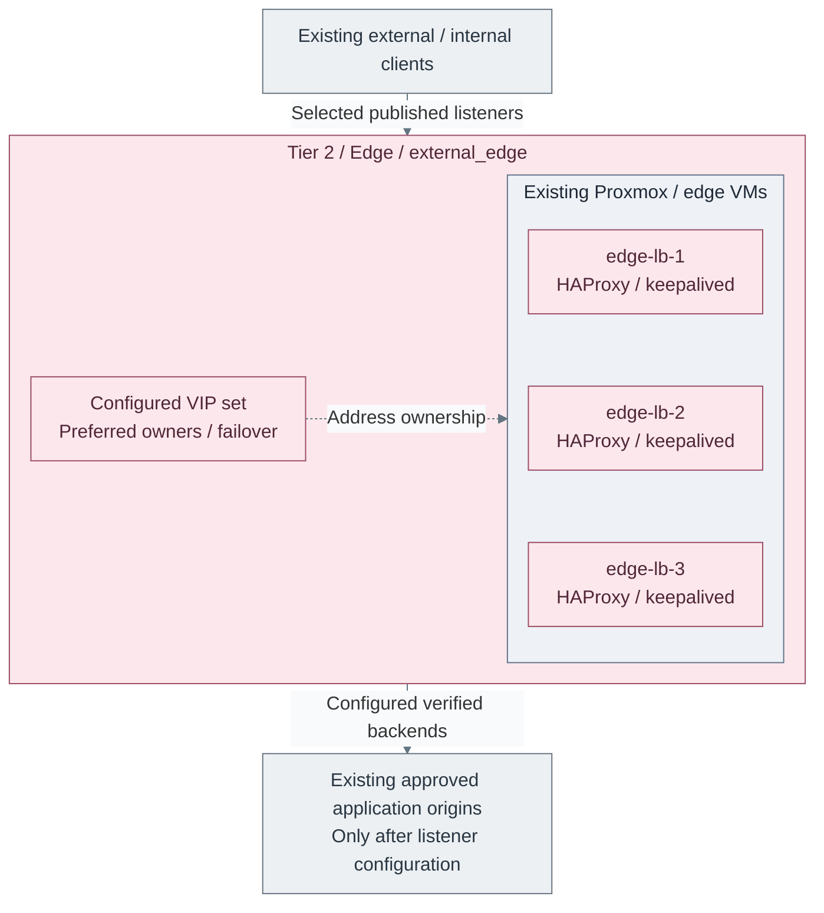

# Edge proxy path

**Working repository:** `<prefix>-tier-2` (source: `tier-2/`).
Run repository scripts from this root; paths below are repository-relative.

**Design:** [traffic boundaries](../../../architecture/delivery/README.md).

## Main path

1. [Initialize and configure](#configuration)
2. [Plan and deploy](#plan-and-deploy)
3. [Verify before publication](#verify-before-publication)

Defaults and VIP behavior below explain the pattern; the starter has no application
frontends/backends enabled. Provisioning the edge set alone does not publish an application.

## Purpose

Use this path from Tier 2 to deploy the public `external_edge` load-balancer layer. This
is the north-south boundary for public application listeners and approved backend
load balancing. Outbound proxy/cache is a separate `cache` deployment.

The reference implementation is `HAProxy` with `keepalived`. The default is a
3-node edge set with multiple VIPs. Each VIP has a different preferred owner,
so healthy traffic is spread while every VIP can still fail over.

## Default deployment



**IaC:** Tier 2 [edge inputs](../../../../tier-2/terraform/deployments/edge/terraform.tfvars.example)
and [edge recipe](../../../../tier-2/ansible/playbooks/deployment/edge-proxy.yml).
The starter creates three VMs and configures the VIP/service machinery, but has no application listeners enabled.
The drawn client/backend traffic exists only after reviewed listener, TLS and firewall configuration.

| Component | Terraform default | Inventory entry | Network key | Purpose |
| --- | --- | --- | --- | --- |
| edge load balancers | `edge-lb-1`, `edge-lb-2`, `edge-lb-3` active | present by default | `external_edge` | public ingress and application load balancing |
| extra edge nodes | add matching inventory and IP entries | not present by default | `external_edge` | more capacity, site spread, or policy separation |

The default uses three nodes so one edge host can be updated or changed while
traffic still has two remaining edge hosts. This is not cluster quorum in the
database sense; it is an operational HA pattern for maintenance headroom and
better VIP distribution.

## VIP distribution

Use one keepalived `vrrp_instance` per VIP. Each VIP needs its own
`virtual_router_id`, and all nodes stay in `BACKUP` state so priority decides
ownership after restarts.

The example rotates priority ownership:

| VIP | Preferred owner | First backup | Second backup |
| --- | --- | --- | --- |
| `internal_prod` | `edge-lb-1` | `edge-lb-2` | `edge-lb-3` |
| `internal_services` | `edge-lb-2` | `edge-lb-3` | `edge-lb-1` |
| `dmz_ingress` | `edge-lb-3` | `edge-lb-1` | `edge-lb-2` |

Normal state:

```text
edge-lb-1 owns internal_prod
edge-lb-2 owns internal_services
edge-lb-3 owns dmz_ingress
```

During a failure, the affected VIP moves to its next highest-priority backup.
That gives the edge layer "spread when healthy, consolidate only during
failure" behavior.

HAProxy uses nonlocal bind by default, so every edge node can load the same
frontend configuration even when it does not currently own every VIP.

Use VIP names as policy boundaries, not only as addresses:

| VIP type | Typical traffic | Why it is separate |
| --- | --- | --- |
| `internal_prod` | approved application APIs, ingress and user interfaces | stable application delivery and user/service traffic |
| `internal_services` | separately approved platform application listeners, not privileged control APIs | separate application access policy; the name grants no Tier 0 access |
| `dmz_ingress` | internet-facing or externally reachable services | tighter exposure control and separate firewall/TLS policy |

Additional application VIPs may separate firewall rules, certificates, logging
or maintenance ownership. Proxmox, privileged jump access, secret/PKI administration
and Kubernetes control APIs use protected paths owned by their respective tiers,
not this Tier 2 edge deployment.

## Service shape

| Service | Default role |
| --- | --- |
| `HAProxy` | runs the edge load-balancer configuration |
| `keepalived` | owns edge VIPs and fails them over between edge hosts |
| local HAProxy stats | enabled on `127.0.0.1:8404` for local checks |

<a id="what-you-configure"></a>

## Configuration

Initialize local inputs from Tier 2 before editing their example-derived live files:

```bash
bash scripts/init-local-files.sh --setup edge
```

| Repository | Path inside that repository | Configuration |
| --- | --- | --- |
| Tier 2 | [`terraform/common.tfvars.example`](../../../../tier-2/terraform/common.tfvars.example) | `external_edge` attachment and optional overrides; common storage and local SSH paths follow [platform inputs](../../../reference/platform-inputs.md) |
| Tier 2 | [`terraform/deployments/edge/terraform.tfvars.example`](../../../../tier-2/terraform/deployments/edge/terraform.tfvars.example) | edge VM count, size, storage, and tags |
| Tier 2 | [`ansible/inventory/hosts.yml.example`](../../../../tier-2/ansible/inventory/hosts.yml.example) | `edge_load_balancers` host group |
| Tier 2 | [`ansible/group_vars/all.yml.example`](../../../../tier-2/ansible/group_vars/all.yml.example) | hostname, domain, SSH, and baseline settings |
| Tier 2 | [`ansible/group_vars/edge.yml.example`](../../../../tier-2/ansible/group_vars/edge.yml.example) | edge host IPs, VIPs, keepalived router IDs, rotated priorities, HAProxy stats listener, and frontend/backend entries |

The Tier 2 [deployment recipe](../../../../tier-2/ansible/playbooks/deployment/edge-proxy.yml)
uses its [edge_load_balancer role](../../../../tier-2/ansible/roles/edge_load_balancer/).
Shared supplies the [deploy helper](../../../../shared/scripts/deploy.sh) and
[Keepalived primitive](../../../../shared/ansible/roles/shared/tasks/keepalived.yml),
not the edge inventory, Terraform or frontend definitions.

## Plan and deploy

Configure host IPs, unused VIPs/VRRP IDs and approved application frontends/backends.
For multiple environments, complete [environment isolation](../../../reference/repository-scripts.md#environment-isolation).

```bash
bash scripts/deploy.sh edge --plan-only
```

Review the resources and listeners, then deploy:

```bash
bash scripts/deploy.sh edge
```

## Verify before publication

For a browser-facing website, use the [public HTTPS procedure](../../stage-9-workloads/public-https.md)
for HTTP-01, trusted public certificates, verified origin TLS and scheduled renewal.
The generic edge recipe does not select or obtain those certificates on its own.

1. Test the selected VIP/listener from an approved internal client, backend health,
   TLS/service hostname and denied access from an unauthorized subnet.
2. Verify VIP failover on disposable traffic; check remaining capacity and endpoint
   continuity before relying on the HA pattern.
3. Publish only the selected application DNS/NAT/firewall path. Keep administrative
   APIs private, and test the actual WAN/VPN path and IPv6 policy separately.

Never open the whole edge host or backend subnet merely because one app works.
Retain [logging and recovery](../../../administration/README.md) before carrying important traffic.

## How other paths use it

Application paths supply approved backend references to the Tier 2 edge owner.
Only reviewed application listeners are published. Internal Kubernetes API,
Tier 0 administration and foundational signing use independent protected paths.
An optional consumer-facing cryptography API needs the separate
[publication contract](../../../architecture/cryptography/usb-hsm.md#authority-and-transport);
it is never Tier 0's internal or recovery route.

Keep this boundary:

- the edge setup owns the edge hosts
- service paths own their backend snippets or routing entries
- edge VIPs are stable addresses other services consume
- raw service protocols should not be exposed directly through the edge layer
- more edge nodes are added by extending `vm_instances`, inventory, and IP map

## Read more

- [Shared services path](../../../reference/implementation-support.md)
- [Network architecture](../../../architecture/networking/README.md)
