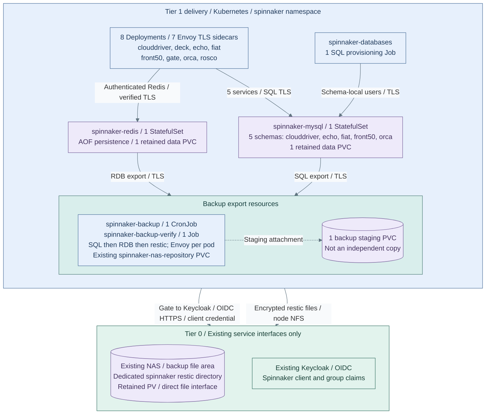

# Step 2b: Spinnaker Release Pipelines

**Working repository:** `<prefix>-tier-1`.
**Branch from:** [Step 2](README.md#step-2-select-and-qualify-delivery).
**Change:** install native Spinnaker release pipelines instead of Argo CD application GitOps.
**Prerequisites:** accepted Tier 1 cluster, storage, private DNS, Traefik,
preissued TLS Secrets and Keycloak. An independently commissioned cert-manager issuer
is an explicit alternative, not a prerequisite silently supplied by OpenXPKI.

The [delivery role](../../../tier-1/ansible/roles/delivery_platform/) supplies the
upstream service base, configuration, SQL/Redis provisioning and staged installation.
No external product overlay, Halyard or operator is required. Offline render tests
are not live SSO, migration, deployment or recovery acceptance; complete the checks below
before marking this site's v1.0 Spinnaker path ready.

## Contents

- [Installation decision](#installation-decision)
- [Prepare local inputs](#step-1-prepare-local-inputs)
- [Commission certificates](#commission-certificates)
- [Credentials and boundaries](#step-2-prepare-credentials-and-boundaries)
- [Choose backup storage](#choose-backup-storage)
- [Render, review and install](#step-3-render-review-and-install)
- [Qualify delivery](#step-4-qualify-delivery)
- [Maintenance and recovery](#maintenance-and-recovery)
- [Verification](#verification)
- [References](#references)

## Installation Decision

Use the official native Kustomize installation model. [1] The exact released
Spinnaker image version, upstream revision and dependency images are centralized in
`ansible/roles/delivery_platform/files/software.yml`. The role vendors only eight
services' native manifests and Deck settings. `files/spinnaker/upstream.yml`
records source paths and canonical SHA256 checksums; adjacent `LICENSE` and
`NOTICE` preserve Apache-2.0 provenance. The local root Kustomization selects
those services; generated patches replace the upstream demo's moving tags, basic
login, disabled Fiat and cluster-admin binding.

| Choice | Rationale and consequence |
| --- | --- |
| Native upstream manifests | Current official OSS installation model; Tier 1 owns this integration and upgrades, not a new operator [1] |
| One MySQL instance, five schemas | Echo's released Quartz schema and driver require MySQL; one supported engine avoids an unsupported PostgreSQL/CNPG substitution [2] |
| Persistent Redis | Gate sessions and Orca queues remain on Redis; SQL-only queues are not selected [3] |
| Verified Redis TLS sidecar | Envoy verifies the root and exact DNS SAN; Java clients use authenticated loopback Redis, never plaintext pod-to-pod Redis [6] |
| Private JVM HTTPS | Preissued per-service PKCS12 certificates, or an explicitly commissioned issuer; public JVM roots plus site/IdP roots, verified SQL and Traefik-to-Gate TLS [4] |
| Uniform application roles | Fiat grants readers READ and writers WRITE/EXECUTE across applications; per-application metadata cannot broaden this policy |
| No deprecated packager | Halyard, EOL operators and the archived Helm stable chart are not used [1][3] |

This is a single-replica reference, not HA. Storage, ingress, certificate issuance,
identity and independent backup custody retain their existing owners. Review this
decision when upstream changes SQL engines, auth/configuration, Redis client TLS,
packaging or supported Kubernetes versions. Argo CD remains a separate explicit
alternative; `none` selects Harbor only.

The fresh example and following realization select **`filesystem` on an existing
NAS backup file area**; they show configured resources, not live acceptance. The
role retains `s3` when older inputs omit the selector; that is a separate storage
choice under [backup storage](#choose-backup-storage). Cluster ingress/DNS,
the NAS PVC/repository and leaf certificates are existing prerequisites.


**IaC:** [Tier 1 inputs](../../../tier-1/ansible/group_vars/delivery_platform.yml.example),
[native reference](../../../tier-1/ansible/roles/delivery_platform/tasks/spinnaker-native.yml),
[persistence](../../../tier-1/ansible/roles/delivery_platform/templates/spinnaker/persistence.yml.j2),
[backup resources](../../../tier-1/ansible/roles/delivery_platform/templates/spinnaker/backup.yml.j2)
and [staged apply](../../../tier-1/ansible/roles/delivery_platform/tasks/spinnaker-native-apply.yml).
**Prerequisites:** [existing NAS storage](../foundation/procedures/object-storage.md#use-nas-file-storage)
and Keycloak retain their existing owners. Only the commissioned file PVC and OIDC
interface are consumed, never Tier 0 control credentials. No NAS gateway is added.

## Step 1: Prepare Local Inputs

Follow the [common installer prerequisites](procedures/delivery-installer.md#prerequisites)
and populate the ignored local copy of
[delivery_platform.yml.example](../../../tier-1/ansible/group_vars/delivery_platform.yml.example).
Product versions already have released defaults; replace site-specific inputs,
not software versions with arbitrary placeholders.

| Input / prerequisite | Required value |
| --- | --- |
| Controller | `delivery_platform_controller: spinnaker`, `delivery_platform_spinnaker_mode: native`; leave overlay empty |
| Cluster | Tier 1 Kubernetes >=1.33, stable native sidecars, enforced NetworkPolicy and Pod Security Admission |
| Capacity | Eight product Deployments, seven small Envoy sidecars, MySQL and Redis; qualify scheduling and memory against actual worker capacity |
| Storage | Explicit persistent StorageClass; default claims: MySQL 20Gi, Redis 5Gi, backup staging 32Gi; qualify capacity and encrypted storage |
| Certificate owner | `delivery_platform_spinnaker_certificate_mode: preissued` by default; ten independently commissioned leaf Secrets, or explicitly select `issuer` with an existing Ready issuer |
| Independent backup | Fresh example: existing NAS NFS/file PVC and dedicated restic repository (`filesystem`); explicit alternative: existing HTTPS object endpoint and bucket/prefix (`s3`, legacy default); separately retained password in either mode |
| Trust | `delivery_platform_spinnaker_ca_pem` and `delivery_platform_oidc_ca_pem`: one PEM root each; leaf Secrets carry intermediate chains |
| Interface | Private hostname, Traefik ingress class, ingress namespace/pod selector, matching client trust |
| DNS | CoreDNS namespace/pod selector; adapt for NodeLocal DNS or a different resolver |
| Destinations | Explicit dedicated application namespaces on this Tier 1 cluster; no system, controller, identity or trust namespaces |
| Egress | Non-global IP CIDRs and TCP ports for the actual Tier 1 API endpoint, IdP and approved HTTP artifact endpoints |
| Identity | Confidential Keycloak client `spinnaker`, authorization-code flow; flat `groups` claim containing the three configured role names |
| Callback | Exactly `https://<spinnaker-host>/api/v1/login/oauth2/code/platform`; restrict valid origins to the private UI origin |

Set `delivery_platform_install_harbor: false` to install only Spinnaker.
The default ingress namespace is `ingress-system`, DNS is `kube-system`,
and selectors match the shared Traefik/CoreDNS realization. Do not use blanket
egress: resolve and authorize actual endpoint addresses, including the API server's
post-service-translation address where required by the CNI. Account for IdP redirects,
artifact redirects and address changes. Tier 0 IdP/object-storage service endpoints are allowed;
Tier 0 Kubernetes, provisioning, SSH and other control interfaces are not.

## Commission Certificates

The current Stage 4 realization imports leaf certificates. The OpenXPKI software
server does **not** install a cert-manager Issuer, ACME service or automatic service
certificate workflow. This role never creates a CA authority or receives a Tier 0
root/issuer private key. Select one certificate owner before installation:

| Mode | Required commissioning |
| --- | --- |
| `preissued` (default) | Custodian supplies ten `kubernetes.io/tls` Secrets; the role checks them before changes and leaves them under that owner's control |
| `issuer` | Site has independently installed and qualified the configured Issuer/ClusterIssuer for the external hostname and private service DNS; role requests ten leaf Certificates and waits for the current generation to become Ready |

For preissued mode, `spinnaker-tls` must contain the external hostname's full
`tls.crt` chain and `tls.key`. The nine internal Secrets are
`{spinnaker-mysql,spinnaker-redis,clouddriver,echo,fiat,front50,gate,orca,rosco}-tls`.
Each needs `tls.crt`, `tls.key`, and `ca.crt`; the seven JVM services additionally
need binary `keystore.p12`. Every internal certificate needs serverAuth and DNS SANs
`<service>`, `<service>.<namespace>`, `<service>.<namespace>.svc`, and
`<service>.<namespace>.svc.cluster.local`. The corresponding public root belongs in
`delivery_platform_spinnaker_ca_pem`; certificates must serve their intermediate chain.

Request approved leaf material from the PKI custodian. With files in private
`$SPINNAKER_TLS_DIR/<service>/{tls.crt,tls.key,ca.crt}` and a protected
`$SPINNAKER_TLS_DIR/keystore.password`, import them from an authorized Tier 1 worker:

```bash
: "${KUBECONFIG:?Set the Tier 1-only kubeconfig}"
: "${TIER1_CONTEXT:?Set the exact Tier 1 context}"
: "${SPINNAKER_TLS_DIR:?Set the private preissued leaf directory}"
kubectl --context "$TIER1_CONTEXT" create namespace spinnaker --dry-run=client -o yaml |
  kubectl --context "$TIER1_CONTEXT" apply -f -
for service in spinnaker spinnaker-mysql spinnaker-redis clouddriver echo fiat front50 gate orca rosco; do
  directory="$SPINNAKER_TLS_DIR/$service"
  files=(--from-file=tls.crt="$directory/tls.crt" --from-file=tls.key="$directory/tls.key")
  case "$service" in
    spinnaker) ;;
    spinnaker-mysql|spinnaker-redis) files+=(--from-file=ca.crt="$directory/ca.crt") ;;
    *)
      openssl pkcs12 -export -name spinnaker -in "$directory/tls.crt" -inkey "$directory/tls.key" \
        -certfile "$directory/ca.crt" -passout "file:$SPINNAKER_TLS_DIR/keystore.password" \
        -out "$directory/keystore.p12"
      files+=(--from-file=ca.crt="$directory/ca.crt" --from-file=keystore.p12="$directory/keystore.p12") ;;
  esac
  kubectl --context "$TIER1_CONTEXT" -n spinnaker create secret generic "$service-tls" \
    --type=kubernetes.io/tls "${files[@]}" --dry-run=client -o yaml |
    kubectl --context "$TIER1_CONTEXT" apply -f -
done
```

Use the actual selected namespace if it differs from `spinnaker`. Supply the
same password-file content as `spinnaker-keystore/password`, including bootstrap
mode: preissued PKCS12 passwords are never randomly regenerated. Verify each leaf's
chain, SANs, expiry and matching private key and open each PKCS12 with this password
before import. Renew through the selected owner and roll out consumers after replacement.

## Step 2: Prepare Credentials and Boundaries

The default `delivery_platform_manage_secrets: false` requires existing Secrets in
the Spinnaker namespace, supplied by one accepted credential owner:

| Secret | Required keys |
| --- | --- |
| `spinnaker-oidc` | `clientSecret`: actual registered Keycloak client credential |
| `spinnaker-mysql-root` | `password` |
| `spinnaker-redis-auth` | `password` |
| `spinnaker-keystore` | `password` |
| `spinnaker-backup` | Both backends: `RESTIC_PASSWORD` (at least 32 characters); `s3` additionally: `AWS_ACCESS_KEY_ID`, `AWS_SECRET_ACCESS_KEY` |
| `spinnaker-{clouddriver,echo,fiat,front50,orca}-db` | Each has separate `password` and `migration-password` |

Dependency passwords must be independent 32-128 character ASCII alphanumeric values.
For explicit bootstrap ownership, set `delivery_platform_manage_secrets: true`
and supply the actual OIDC and independent backup credentials, plus the matching
preissued keystore password, in the private
[secret input](../../../tier-1/ansible/group_vars/delivery_platform_secrets.yml.example).
The role generates stable 48-character dependency passwords under the private
output's `credentials/` directory; explicit supplied values must pass validation.
Protect and back up this directory, never delete it and regenerate passwords against
existing database PVCs. Do not run bootstrap and an external Secret controller together.

The role consumes the ten commissioned leaf Secrets (or requests them only in
explicit issuer mode), derives Redis's hashed ACL and the public ingress CA Secret,
and builds JVM truststores from public roots without Tier 0 private keys.
Runtime/migration SQL users have grants only on their own schema. MySQL root is
mounted only by MySQL and the provisioning/backup Jobs, never product services.

For each declared target the role creates a namespace-scoped ServiceAccount, Role,
RoleBinding and explicit service-account-token Secret. Only that restricted token
and API CA are copied into Clouddriver's account mount. The installer kubeconfig is
never copied. These are long-lived integration credentials: revoke by deleting the
RoleBinding and token Secret, then rotate and rerun installation.

Target namespaces enforce the Kubernetes restricted Pod Security profile. They
must not contain privileged ServiceAccounts or unrelated sensitive Secrets:
permission to create workloads is authority over that namespace. Roles cannot manage
Secrets, RBAC, ServiceAccounts, namespaces, nodes, exec or cluster-scoped resources.
Provision application Secrets and RBAC through their independent owner first.
This native reference does not register remote Tier 2 clusters or Tier 0 targets.

## Choose Backup Storage

The fresh example sets `delivery_platform_spinnaker_backup_backend: filesystem`.
Existing inputs keep `s3` when the selector is omitted. Both modes consume already
commissioned storage, export SQL/RDB through the staging PVC, encrypt with restic,
then verify all repository data before removing successful staging. [7]

| Backend | Required existing storage and inputs |
| --- | --- |
| `filesystem` | Dedicated NAS export/dataset via a preprovisioned PVC in the Spinnaker namespace; inputs below |
| `s3` (default) | Native HTTPS object endpoint, private bucket/prefix, public CA and scoped key; existing `backup_s3_endpoint`, `backup_s3_bucket`, `backup_s3_region`, `backup_s3_prefix`, `backup_ca_pem` and `backup_egress` inputs retain their meaning (all prefixed `delivery_platform_spinnaker_`) |

### Direct NAS File Repository

The storage owner commissions a dedicated NAS NFS export or NAS-backed file CSI
volume, outside the cluster's data lifecycle, and creates its namespace, PV and PVC
before apply. The role requires a Bound filesystem claim, an exact PV claim binding,
`Retain` reclaim policy and a writable NFS/CSI source. It rejects local/hostPath PVs;
the operator must verify a CSI driver's actual remote NAS backing. The role never
creates, formats, initializes or deletes the NAS volume or file repository. [8]

| Full input prefix: `delivery_platform_spinnaker_backup_` | Filesystem value |
| --- | --- |
| `backend` | `filesystem` |
| `filesystem_claim` | Existing PVC name, distinct from SQL, Redis and `spinnaker-backup` staging |
| `filesystem_repository` | One directory name under the PVC root; default `spinnaker`; no slashes or traversal |
| `filesystem_marker` | Exact 32-128 character ASCII alphanumeric/underscore/hyphen identity in `<repository>/.spinnaker-backup-repository` |
| `egress` | Not used in filesystem mode; normally leave `[]` |

Commission a **new** repository once on the verified NAS mount, using the pinned
restic executable and a separately retained password file. Set `SPINNAKER_NAS_MOUNT`
to its actual mountpoint. Run with an authorized storage identity; leave repository
files writable by the backup pod's UID/GID `999`, including under NFS root squash.
Existing repositories keep their original password and marker; skip initialization.

```bash
export RESTIC_REPOSITORY="${SPINNAKER_NAS_MOUNT:?Set the verified NAS mountpoint}/spinnaker"
export RESTIC_PASSWORD_FILE=/absolute/private/spinnaker-restic.password
mountpoint -q "$SPINNAKER_NAS_MOUNT" || exit 1
test ! -e "$RESTIC_REPOSITORY" && test ! -L "$RESTIC_REPOSITORY" || exit 1
restic init --repository-version 2 || exit 1
openssl rand -hex 32 > "$RESTIC_REPOSITORY/.spinnaker-backup-repository"
```

Copy that marker's value into `filesystem_marker` and supply the same retained
password as `spinnaker-backup/RESTIC_PASSWORD`. AWS keys, object TLS trust and object
egress are unnecessary. Only the restic container mounts the NAS PVC at `/repository`;
dump containers mount staging. The Job checks the actual mount, directory containment,
matching nonsymlink marker, existing restic config and password before writing.
An absent mount, marker or repository fails closed; there is no emptyDir repository
or local-directory fallback. The small emptyDir at `/cache` holds only scratch/cache.

Allow the storage path from Kubernetes **nodes/CSI components** to the NAS through
the storage owner's firewall policy; pod egress rules do not authorize node NFS
mounts. Qualify locking, UID/GID permissions, mount failure/recovery and capacity.
The marker identifies the commissioned repository; it is not an authentication secret.

### Existing Object Endpoint

Supply `spinnaker-backup/AWS_ACCESS_KEY_ID` and `AWS_SECRET_ACCESS_KEY`, plus the
independent `RESTIC_PASSWORD`. Grant only the endpoint IP CIDRs and TCP port in
`delivery_platform_spinnaker_backup_egress`; only backup pods receive these grants
and credentials. S3 mode preserves initialization of a genuinely absent restic
repository; wrong passwords, TLS errors and failed uploads/checks fail the Job. [7]

For IAM-compatible endpoints, review `spinnaker-backup-iam.json`: it confines access
to the selected bucket/prefix and permits deletion only of restic lock objects.
For other native object endpoints, commission equivalent scoped permissions using
that product's supported credential model. This step adds no gateway service.

For either backend, the storage custodian owns retention, independent media copies
and repository maintenance. Jobs never forget or prune snapshots or delete repository
data; restic creates and releases its normal locks. Retain the password separately
from both Kubernetes and the NAS/object service. An accessible PVC or completed Job
does not establish independent failure domains, immutable retention or recovery acceptance.

## Step 3: Render, Review and Install

Use the [common render command](procedures/delivery-installer.md#render-and-apply).
Native rendering is offline: the supplied base, product configuration, dependencies
and scoped target contracts are all included. The output directory contains:

| Output | Review |
| --- | --- |
| `spinnaker-native/` | Complete reproducible Kustomize source and public trust inputs |
| `spinnaker-manifests.yml` | Eight services, configuration, optional leaf Certificate requests, SQL/Redis, SQL and backup-verification Jobs, target identities, policies, ingress and backup CronJob |
| `spinnaker-backup-iam.json` | S3 only: least-privilege policy for IAM-compatible existing object storage; removed from render output in filesystem mode |
| `spinnaker.sha256` | Exact checksum binding the complete render, including target grants |
| `credentials/` | Private stable bootstrap passwords only when bootstrap ownership is selected |

Set `delivery_platform_spinnaker_review_sha256` to the reviewed checksum and use
the same inputs with `delivery_platform_action=apply`. Apply rebuilds and checks
the checksum before cluster access, validates credential fields and OIDC discovery,
and then executes this dependency order:

1. In filesystem mode validate the existing NAS PVC/PV binding and retention first.
   Check StorageClass, preissued TLS Secrets (or explicit ready issuer and cert-manager
   CRDs), Traefik CRD/ingress class and server version before resource changes.
2. Create selected namespaces; provision explicitly owned credentials, public trust
   and hashed Redis ACL; apply configuration, certificates, policies and target RBAC.
3. In issuer mode wait for all current-generation certificates; start MySQL/Redis
   and wait for current-generation persistent replicas.
4. Recreate the transient, idempotent SQL provisioning Job; wait for five schemas,
   schema-local service users and migration users.
5. Wait for target tokens, copy only restricted identities, start the eight services
   and let their native Liquibase migrations complete.
6. Wait for the current application rollout, run and verify a first independent repository
   backup, then publish private ingress and enable the backup CronJob. Verify Gate HTTPS.

Do not apply the combined YAML directly: that bypasses lifecycle ordering and checks.
There is no destructive prune, uninstall, database migration rollback or automatic
storage-size change. The root provisioning Job is deliberately recreated on apply;
all durable configuration is declarative.

Custom `overlay` mode remains an advanced, separately maintained integration:
it requires the prior complete `spinnaker-runtime` Secret, private TLS and additional
dependency/account Secrets. It is not the supplied installer and does not inherit
native dependency provisioning or recovery behavior.

## Step 4: Qualify Delivery

Use real accepted and denied IdP users. Check the flat role claim, browser login,
logout, direct API requests, reader write rejection, writer execution and admin access.
Verify accounts and applications through Fiat, including a nonmember login denial.
Do not accept health probes as proof of authorization. [5]

Create a bounded application/pipeline, consume an approved HTTP artifact, deploy to
the declared namespace, wait for health and roll back. Attempt deployment to another
namespace, Secrets/RBAC creation, privileged pods and a Tier 0 target; all must fail.
Only then transfer ownership of selected objects to the pipeline.

For [Stage 9 GitLab](../stage-9-development/procedures/gitlab.md), consume the same
pinned chart/values and prepared Secret/RBAC inputs as its native installer, bake
manifests and deploy to an approved account. Cluster-scoped dependencies stay with
the cluster owner. A pipeline can instead invoke its native Ansible apply recipe on
an authorized Tier 1 deployment worker, never the Tier 0 infrastructure runner.
Keep bootstrap sources independent until GitLab source migration is accepted.
**Return:** [Step 3](README.md#step-3-connect-approved-artifact-supply).

## Maintenance and Recovery

- Upgrade the central software pins and reviewed vendored base together; verify
  provenance/checksums and render/schema tests, then rehearse native service migrations
  against restored data. Upstream release notes require substantial release qualification. [3]
- Certificate renewal updates mounted Secrets; JVMs need a rollout to reload PKCS12
  keys/trust. After a reviewed certificate, OIDC, SQL, Redis or target-token change,
  increment `delivery_platform_spinnaker_secret_revision`, render/review again and
  reapply. ConfigMap hash changes already trigger configuration rollouts.
- Rotate service/migration passwords with coordinated SQL provisioning and service
  rollouts. MySQL root rotation must change the database account and protected
  Secret/cache together; changing `MYSQL_ROOT_PASSWORD_FILE` does not rotate an
  existing database. Keystore password rotation requires certificate reissuance.
- The native UTC backup CronJob stages five-schema MySQL dumps and Redis RDB exports,
  then writes an encrypted restic snapshot to the selected NAS file or object repository.
  A completed Job includes full data read-back verification; local staging is not
  independent custody. Successful staging is removed immediately; seven-day cleanup
  applies only to old failed exports. Monitor Job failures, PVC and repository capacity.
- Before a recovery rehearsal, stop triggers/writers and scale the eight product
  Deployments to zero. Run a final backup Job from the CronJob while data services
  remain available; wait for both exports. Ordinary scheduled exports are not an
  atomic cross-MySQL/Redis recovery point.
- Restore on an isolated clean target with the same pinned images, retained private
  credentials and reviewed inputs. With a separately held recovery credential and
  the same repository/password (and CA in S3 mode), run `restic snapshots --host spinnaker --tag spinnaker`,
  then `restic restore <reviewed-snapshot-id> --target /absolute/private/recovery`.
  Provision TLS/MySQL/Redis first, restore the SQL
  dump through a temporary MySQL-image Job using VERIFY_IDENTITY, then stop Redis
  and restore its RDB into a fresh data PVC before first startup/AOF creation.
  Restore the five schema users via the provisioning Job, not from global MySQL grants.
- Start services only after restored SQL and Redis are ready. Keep triggers and
  artifact egress denied until checking executions/queues for duplicate or stale work.
  For filesystem recovery, mount the retained NAS export on the clean target and set
  `RESTIC_REPOSITORY` to its original repository directory; retain the marker when
  recommissioning the replacement PVC. Restore SSO, allowed/denied account tests and
  a bounded deployment before returning traffic. Record evidence against the accepted site RPO/RTO.
- To remove a destination, first revoke its RoleBinding/token and copied account
  Secret explicitly. Removing an input does not prune previous credentials or objects.

## Verification

The upstream modules `tests/test_tier_delivery_platform.py`,
`tests/test_tier_spinnaker_reference.py` and `tests/test_tier_spinnaker_backup.py`
exercise source and generated native renders,
payload/license preservation, exact hashes, SQL/TLS/auth wiring, credential stability,
strict Kubernetes schemas and unsafe-input rejection. Test paths are code references,
not generated-document links. See the
[common test procedure](procedures/delivery-installer.md#native-tests).

No live deployment is implied by those checks. Live schema migration, image startup,
IdP login/denial, CNI/ingress behavior, backup and clean-target restore require the
site's acceptance environment.

## References

Storage sources checked 2026-10-27; other sources checked 2026-10-26.
Version/revision values live in the machine-readable role inputs.

1. [Official native installation](https://spinnaker.io/docs/setup/install/).
2. [Native SQL storage](https://spinnaker.io/docs/setup/install/storage/) and
   [Echo scheduler implementation](https://github.com/spinnaker/spinnaker/tree/spinnaker-release-2026.3.2/echo/echo-scheduler).
3. [Release migration warnings and removals](https://spinnaker.io/changelogs/2026.3.0-changelog/).
4. [Spinnaker SSL](https://spinnaker.io/docs/setup/other_config/security/ssl/),
   [cert-manager certificates](https://cert-manager.io/docs/usage/certificate/) and
   [Traefik verified upstream TLS](https://doc.traefik.io/traefik/reference/routing-configuration/kubernetes/crd/http/serverstransport/).
5. [Current OAuth2](https://spinnaker.io/docs/setup/other_config/security/authentication/oauth/) and
   [Fiat authorization](https://spinnaker.io/docs/setup/other_config/security/authorization/).
6. [Redis externalization](https://spinnaker.io/docs/setup/productionize/caching/externalize-redis/) and
   [Envoy TLS verification](https://www.envoyproxy.io/docs/envoy/latest/api-v3/extensions/transport_sockets/tls/v3/common.proto).
7. [Restic local and S3 repositories](https://restic.readthedocs.io/en/stable/030_preparing_a_new_repo.html),
   [backup and verification](https://restic.readthedocs.io/en/stable/040_backup.html)
   and [fail-closed scripting](https://restic.readthedocs.io/en/stable/075_scripting.html).
8. [Kubernetes persistent volumes: binding, NFS, CSI and retention](https://kubernetes.io/docs/concepts/storage/persistent-volumes/).
