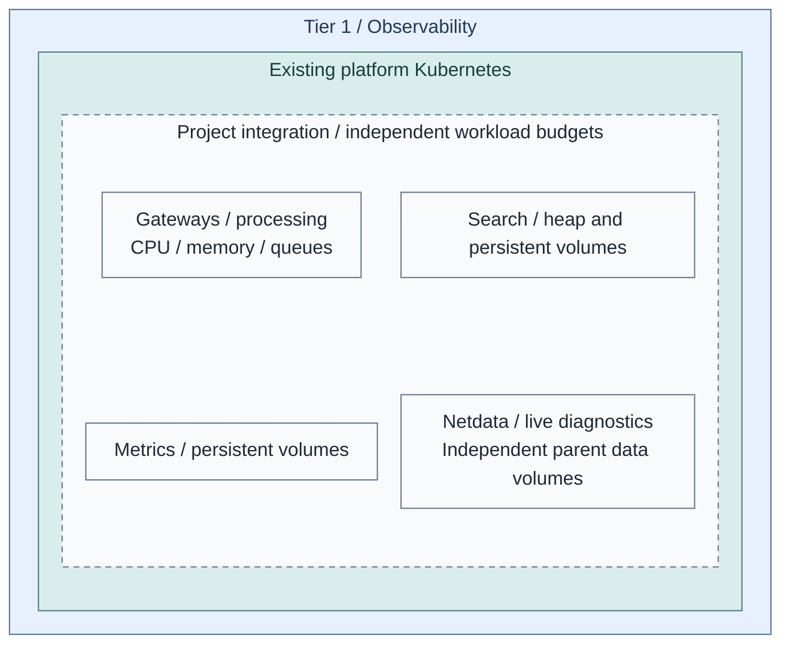
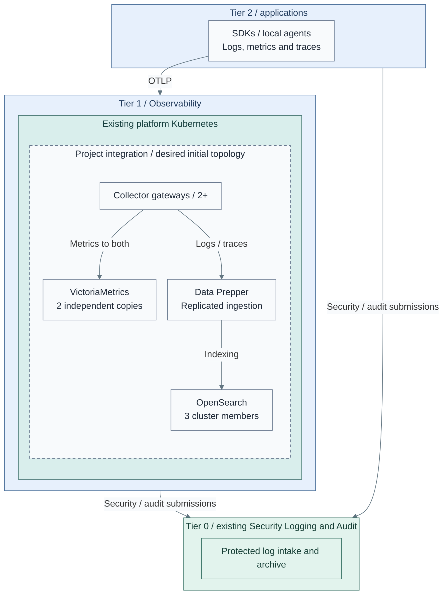
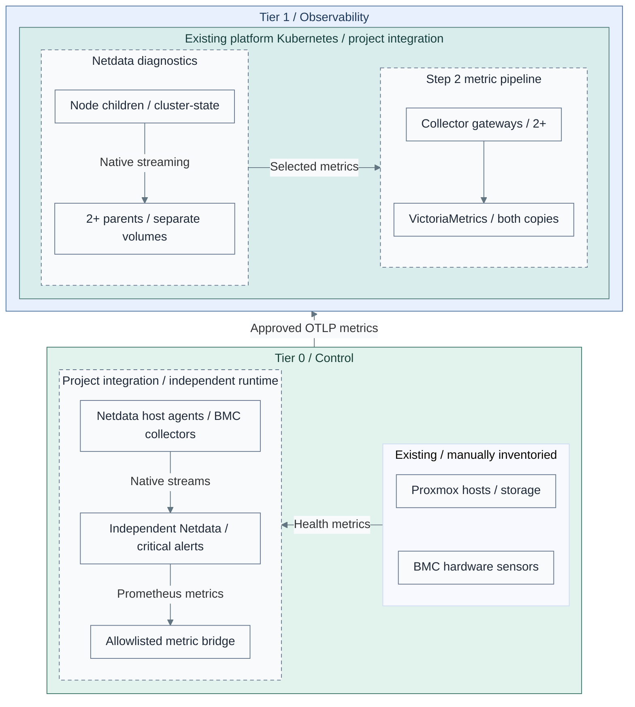
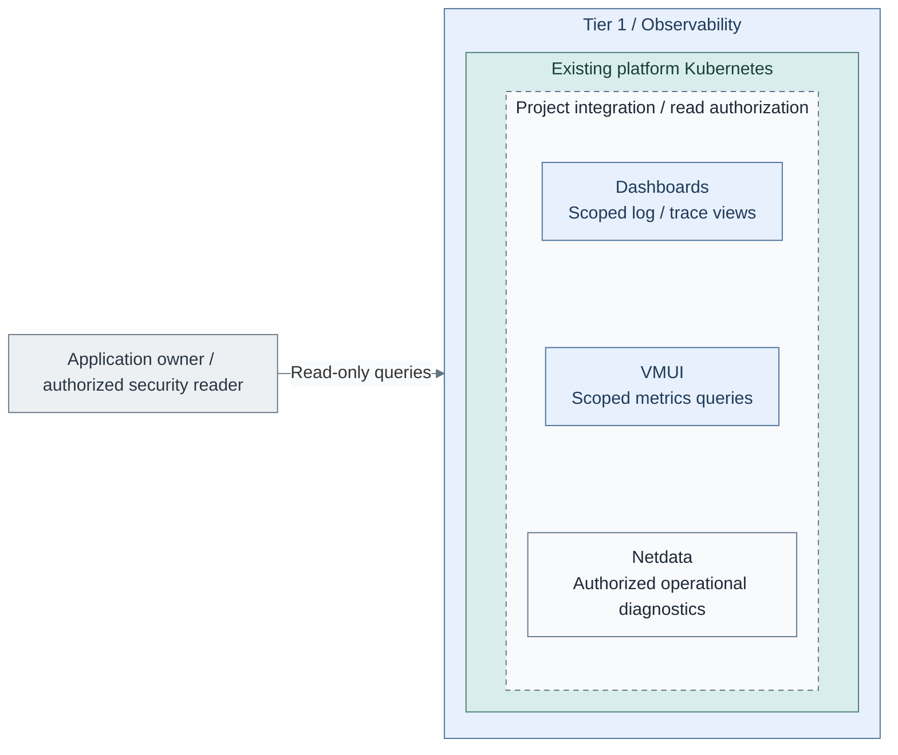

# Stage 8: Observability

Deploy operational visibility for **logs, metrics and distributed traces** in the
existing Tier 1 Kubernetes cluster. OpenSearch is included initially, alongside
the telemetry gateways and metrics backend, not postponed to an optional later stack.
Netdata provides live diagnostics for hosts and Kubernetes; infrastructure monitoring
includes Proxmox, hardware sensors, storage and network health, not only applications.

Earlier [Security Logging and Audit](../stage-2-logging/README.md) preserves Tier 0
evidence. Observability adds diagnosis and scoped queries; it cannot modify that evidence
or administer Tier 0.

**Working repository:** `<prefix>-tier-1` (source: `tier-1/`).
Tier 0 owns infrastructure collection, credentials and approved metric exports.
**Prerequisites:** accepted [Tier 1 platform runtime](../stage-7-delivery/README.md),
[secrets and recovery access](../stage-6-secrets/README.md),
backend worker capacity, persistent storage/backups and source identities.
Equivalent verified existing services can satisfy these contracts.
**Design:** [signals, placement, independent scaling and availability](../../architecture/operations/telemetry.md).
**Automation:** the cluster directory is still an empty integration starter.
The following steps define the required deployment, not an existing product installer.
See [coverage](../../reference/implementation-support.md#stage-coverage) before beginning.

## Main path

1. [Prepare the runtime](#step-1-prepare-the-runtime)
2. [Deploy the signal pipelines](#step-2-deploy-the-signal-pipelines)
3. [Connect infrastructure monitoring](#step-3-connect-infrastructure-monitoring)
4. [Publish and verify read-only views](#step-4-publish-and-verify-read-only-views)

## Step 1: Prepare the runtime

**Integration:** Tier 1 [observability starter](../../../tier-1/clusters/tier1/platform/observability/kustomization.yaml).
It contains no workloads. The [cluster inputs](../../../tier-1/terraform/deployments/kubernetes/terraform.tfvars.example)
supply the underlying runtime, not this application stack.

1. Reuse the [platform cluster](../stage-7-delivery/procedures/platform-cluster.md); do not create another
   Linux VM fleet alongside it. Argo CD or Spinnaker remains the project's delivery choice.
2. Reserve separate gateway, metrics, search, Netdata, processing and UI resources. Protect API/etcd
   capacity; add or size backend workers through the tier-owned cluster inputs when needed.
3. Select supported, pinned native operators/charts and persistent-volume classes.
   Configure topology spread/anti-affinity against physical failure domains, not only VM names.

Use the documented [Collector operator](https://opentelemetry.io/docs/platforms/kubernetes/operator/),
[VictoriaMetrics operator](https://docs.victoriametrics.com/operator/) and
[OpenSearch operator](https://docs.opensearch.org/latest/install-and-configure/install-opensearch/operator/index/) paths.
Use Netdata's [native chart](https://learn.netdata.cloud/docs/netdata-agent/installation/kubernetes-helm-chart-reference)
for the selected child, cluster-state and parent workloads; qualify host access against
the node OS and Pod Security policy. A pod in a guest does not monitor the Proxmox host.
Store reviewed manifests/values in the Tier 1 starter, then reconcile with its selected controller.
No single umbrella all-in-one workload is required.

**Alternative:** [1b: dedicated VMs](step-1b-dedicated-vms.md)
replace the relevant hosting selection; they are not extra default capacity.

## Step 2: Deploy the signal pipelines

**Integration:** implement the desired topology in Tier 1's
[observability directory](../../../tier-1/clusters/tier1/platform/observability/kustomization.yaml).
The depicted product replicas and connections are not installed by the empty starter
or by the VM baseline recipe.

| Workload | Initial availability target | Independent scaling |
| --- | --- | --- |
| Collector gateways | At least two, with bounded persistent exporter queues | Signal throughput, transformations, memory and queue pressure |
| Metrics | Two independent stores with writes to both and tested read failover | Time-series cardinality, sample/query rate, retention and I/O |
| OpenSearch | Three cluster-manager-eligible/data members for the small reference, with replica shards | Heap, shards, indexing/query load and storage; separate manager/data pools as needed |
| Data Prepper | Replicated processing with tested source/queue semantics | Log/trace processing, independent of the search-store node count |
| UIs / query routing | Redundant stateless frontends; native VMUI and Dashboards | Query/session demand, not backend disk capacity |
| Netdata diagnostics | At least two independently persisted parents, child failover and parent synchronization | Host/chart count, streaming rate, history and diagnostic queries |

1. Deploy gateways and **both** stateful backends. Connect metrics to each metrics
   replica; a load-balanced write Service across independent stores would split the dataset.
   Route each log/trace record through the selected search ingestion pipeline, not a fan-out
   that indexes it once per cluster member.
2. Configure authenticated TLS endpoints, pipeline ownership, retry/storage limits and
   signal-specific processing. Preserve metric single-writer rules and trace affinity when
   stateful processing requires it; do not scale by replica count alone.
3. Test a complete worker/physical-host loss, endpoint failure, queue replay, search
   quorum/shards, metric catch-up and backup restore. Keep lagging metric copies out of
   complete-result read routing until they catch up. Record accepted tail loss and RTO.

OpenSearch is a backend; OpenSearch Dashboards is its UI. VMUI supplies the initial
metrics query interface; neither UI requires a dedicated VM. Monitoring rules and
notification routing can use vmalert/Alertmanager, with separate resource and HA budgets.
Tier 0 independent monitoring remains available if this entire cluster fails.

## Step 3: Connect infrastructure monitoring

**Integration:** Tier 1's [observability starter](../../../tier-1/clusters/tier1/platform/observability/kustomization.yaml)
does not install the pictured Netdata or collection workloads. Tier 0's
[local inventory](../../../tier-0/ansible/inventory/hosts.yml.example) identifies approved targets;
it does not install host agents or BMC pollers. This view adds diagnostics and approved
infrastructure metrics to Step 2; its search/evidence paths are unchanged and omitted here.
The picture follows Netdata host/BMC collection; API-only sources can feed the local
metric bridge directly as described in the guide. Native streaming is not OTLP.
Physical infrastructure is on the right; metric delivery to collectors points left.

1. Follow [infrastructure monitoring](infrastructure-monitoring.md) to register sources,
   select host/API/Redfish/IPMI collectors and prepare read-only Tier 0 identities.
2. Configure native Netdata streams and the explicit metric bridge. Keep Proxmox/BMC
   credentials and critical alerting in Tier 0; Tier 1 receives approved metrics only.
   These are [separate diagnostic domains](../../architecture/operations/telemetry.md#infrastructure-coverage),
   not duplicate collection of every host or mutual failover parents.
3. Verify source coverage, stale-data alerts, parent failover and physical-host loss.
   Power off Tier 1 and prove [independent monitoring](../stage-6-secrets/monitoring.md)
   still detects infrastructure failures without its dashboards or normal SSO.

**Result:** platform operators can diagnose infrastructure and applications, without
giving the observability cluster infrastructure-control or protected-archive powers.

## Step 4: Publish and verify read-only views

**Integration:** supply Tier 1 [query and access configuration](../../../tier-1/clusters/tier1/platform/observability/kustomization.yaml).
This view shows query interfaces; backend placement and replica counts remain as
defined in Step 2. Readers enter from the left and query Tier 1 only. Tier 0 originals are outside
this query view: no archive mount or write path is granted. Export/redaction remains
separately authorized in Tier 0 before an approved copy reaches OpenSearch.

1. Authorize and redact exports in Tier 0 before transfer. The export identity receives
   only its approved scope; it has no archive write/delete, retention or backup powers.
   Authenticated routing assigns application ownership; submitted labels are not authority.
2. Give readers the required index, document and field scopes in OpenSearch.
   Remove write/delete, index-management and retention actions explicitly; document/field
   filters do not remove separately granted write permissions. Dashboard tenants alone
   do not enforce record-level isolation. Follow the [read-boundary design](../../architecture/operations/telemetry.md#read-boundaries).
   Restrict Netdata to authorized operators; do not expose raw Tier 0 diagnostics or
   Functions to application readers. A chart filter is not an access-control boundary.
3. Test direct APIs, combined roles, forged ownership, cross-application access and SSO
   outage. Delete/rebuild a disposable Tier 1 index and prove Tier 0 originals remain unchanged.
   Reindexing never writes back to original evidence.

An app owner receives an application-log view, not raw Tier 0 archive access.
Authorized security roles may receive broader approved projections, not Tier 0 mutation rights.
Changing or deleting a search copy does not change the original retained log.

## IaC locations

| Repository | Path | Coverage |
| --- | --- | --- |
| Tier 1 | [clusters/tier1/platform/observability/](../../../tier-1/clusters/tier1/platform/observability/) | Netdata, pipeline/backends, UIs and policy integration; currently empty |
| Tier 1 | [terraform/deployments/kubernetes/](../../../tier-1/terraform/deployments/kubernetes/) | Existing cluster and separately sized workers |
| Tier 1 | [terraform/deployments/observability/](../../../tier-1/terraform/deployments/observability/) | Explicit VM alternative only |
| Tier 0 | [protected logging](../stage-2-logging/README.md) | Original evidence and approved export boundary |
| Tier 0 | [inventory](../../../tier-0/ansible/inventory/hosts.yml.example) and [independent monitoring](../stage-6-secrets/monitoring.md) | Infrastructure targets, local credentials and collector/export integration; no product installer |

## Capability available

**Result:** the [Observability design](../../architecture/operations/telemetry.md)
provides operational logs, metrics, distributed traces and scoped read-only views,
plus Netdata diagnostics and infrastructure health, with the selected redundancy,
recovery and loss limits demonstrated.
Original security evidence and independent foundation alerts remain Tier 0-owned.

Record deployment and acceptance evidence; the empty starter does not meet this gate.
Continue with [Stage 9: Workload provisioning](../stage-9-workloads/README.md)
and its [collection path](../stage-9-workloads/telemetry.md). Do not add a second
syslog archive merely because an operational UI needs approved log visibility.
