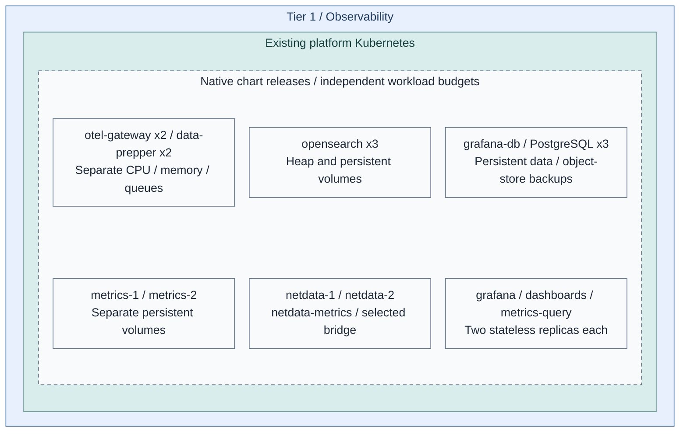
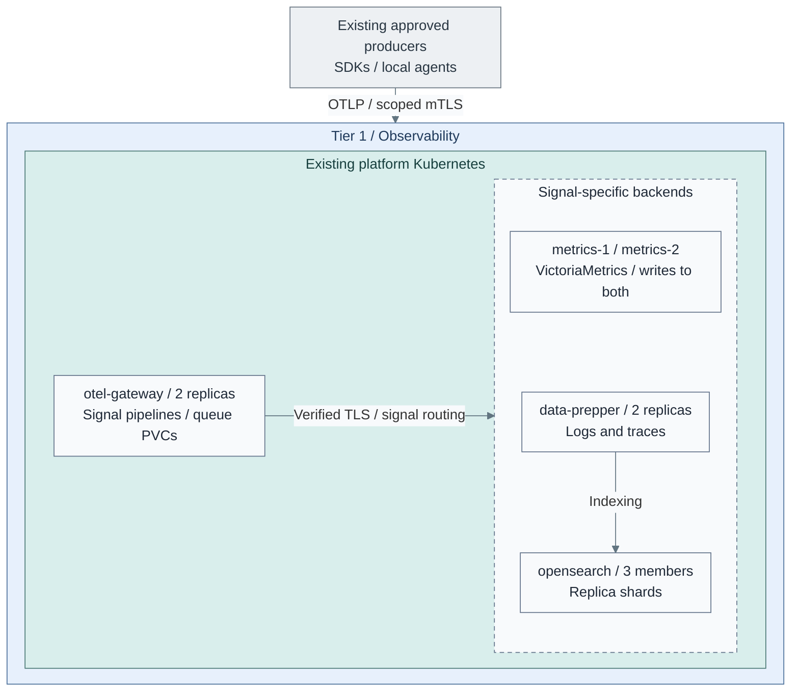
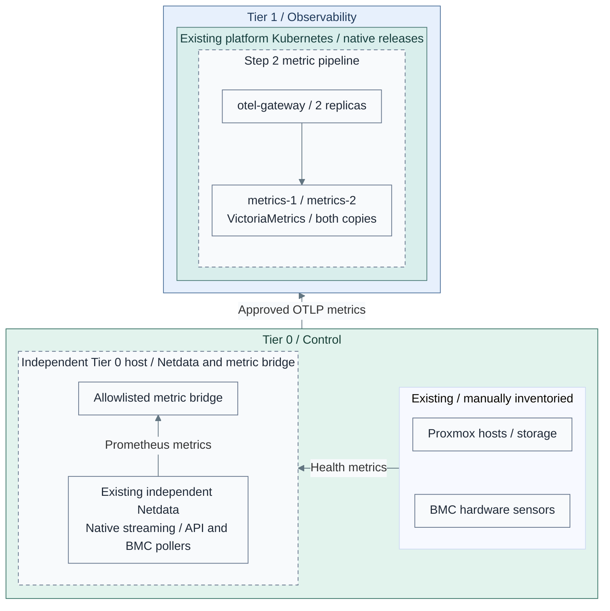
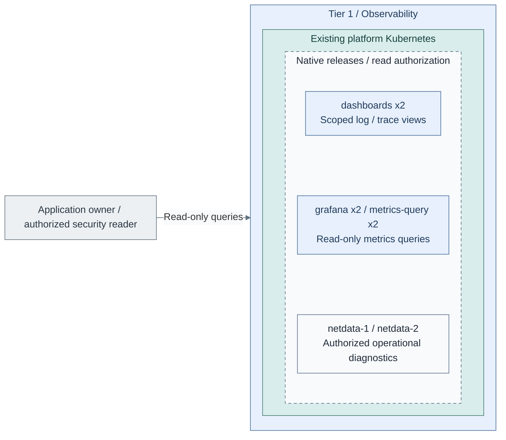

# Stage 8: Observability

Deploy operational visibility for **logs, metrics and distributed traces** in the
existing Tier 1 Kubernetes cluster. OpenSearch is included initially, alongside
the telemetry gateways and metrics backend, not postponed to an optional later stack.
Netdata provides live diagnostics for hosts and Kubernetes; infrastructure monitoring
includes Proxmox, hardware sensors, storage and network health, not only applications.

Earlier [Security Logging and Audit](../stage-2-logging/README.md) preserves Tier 0
evidence. Observability adds diagnosis and scoped queries; it cannot modify that evidence
or administer Tier 0.

**Working repository:** `<prefix>-tier-1` (source: `tier-1/`).
Tier 0 owns infrastructure collection, credentials and approved metric exports.
**Prerequisites:** accepted [Tier 1 platform runtime](../stage-7-delivery/README.md),
[secrets and recovery access](../stage-6-secrets/README.md),
backend worker capacity, persistent storage/backups and source identities.
Equivalent verified existing services can satisfy these contracts.
**Design:** [signals, placement, independent scaling and availability](../../architecture/operations/telemetry.md).
**Automation:** the dedicated [Ansible deployment](../../../tier-1/ansible/playbooks/deployment/observability-platform.yml)
renders or applies the [native chart values](../../../tier-1/ansible/roles/observability_platform/).
The cluster directory remains an empty integration starter, not a second executor.
Read [configuration, secrets and private intake](configuration.md) before beginning.
See [stage coverage](../../reference/implementation-support.md#stage-coverage) for
commissioning, optional variants and live acceptance boundaries.

## Main path

1. [Prepare the runtime](#step-1-prepare-the-runtime)
2. [Deploy the signal pipelines](#step-2-deploy-the-signal-pipelines)
3. [Connect infrastructure monitoring](#step-3-connect-infrastructure-monitoring)
4. [Publish and verify read-only views](#step-4-publish-and-verify-read-only-views)

## Step 1: Prepare the runtime

**IaC:** Tier 1's [playbook](../../../tier-1/ansible/playbooks/deployment/observability-platform.yml),
[role](../../../tier-1/ansible/roles/observability_platform/) and
[inputs](../../../tier-1/ansible/group_vars/observability_platform.yml.example) own these workloads.
The [cluster inputs](../../../tier-1/terraform/deployments/kubernetes/terraform.tfvars.example)
supply the existing runtime. This configured topology is not evidence of live deployment.

1. Reuse the [platform cluster](../stage-7-delivery/procedures/platform-cluster.md); do not create another
   Linux VM fleet alongside it. Argo CD or Spinnaker remains the project's delivery choice.
2. Reserve separate gateway, metrics, search, Netdata, processing and UI resources. Protect API/etcd
   capacity; add or size backend workers through the tier-owned cluster inputs when needed.
3. Select supported, pinned native operators/charts and persistent-volume classes.
   Configure topology spread/anti-affinity against physical failure domains, not only VM names.

The main path uses official product charts and native CNPG database resources. [1][2][3]
Stage 4 must supply a compatible PostgreSQL operator. Qualify Netdata host access against
the node OS and Pod Security policy. A pod in a guest does not monitor the Proxmox host.
Its two parents use separate namespaces because the chart has fixed configuration names. [4]

**Alternative:** [1b: dedicated VMs](step-1b-dedicated-vms.md)
replace the relevant hosting selection; they are not extra default capacity.

## Step 2: Deploy the signal pipelines

**IaC:** the [release specification](../../../tier-1/ansible/roles/observability_platform/templates/releases.yml.j2)
declares dependency order; [configuration](configuration.md) maps products to native values,
Secrets, persistence and health gates. The VM baseline remains a separate alternative.
Scope: the Tier 1 ingestion/backends subset, not the UIs or every existing source.
Producers already exist; this step installs no workload agents. Security/audit
submissions still use the accepted direct Tier 0 path from Stage 4, omitted here;
these analytical pipelines do not replace protected logging.

| Workload | Initial availability target | Independent scaling |
| --- | --- | --- |
| Collector gateways | At least two, with bounded persistent exporter queues | Signal throughput, transformations, memory and queue pressure |
| Metrics | Two independent stores with writes to both and tested read failover | Time-series cardinality, sample/query rate, retention and I/O |
| OpenSearch | Three cluster-manager-eligible/data members for the small reference, with replica shards | Heap, shards, indexing/query load and storage; separate manager/data pools as needed |
| Data Prepper | Replicated processing with tested source/queue semantics | Log/trace processing, independent of the search-store node count |
| UIs / query routing | Replicated vmauth, Grafana and Dashboards; Grafana database has three native CNPG instances | Query/session demand, not backend disk capacity |
| Netdata diagnostics | At least two independently persisted parents, child failover and parent synchronization | Host/chart count, streaming rate, history and diagnostic queries |

1. Deploy gateways and **both** stateful backends. Connect metrics to each metrics
   replica; a load-balanced write Service across independent stores would split the dataset.
   Route each log/trace record through the selected search ingestion pipeline, not a fan-out
   that indexes it once per cluster member.
2. Configure authenticated TLS endpoints, pipeline ownership, retry/storage limits and
   signal-specific processing. Preserve metric single-writer rules and trace affinity when
   stateful processing requires it; do not scale by replica count alone.
3. Test a complete worker/physical-host loss, endpoint failure, queue replay, search
   quorum/shards, metric catch-up and backup restore. Keep lagging metric copies out of
   complete-result read routing until they catch up. Record accepted tail loss and RTO.

OpenSearch is a backend; OpenSearch Dashboards is its UI. Grafana queries the read-only
vmauth route, which admits only explicitly promoted, caught-up metrics copies. Native VMUI
is backend administration. Shared application rules and notification services are an additional
selection: no vmalert/Alertmanager release is installed, and Grafana alerting is disabled here.
Tier 0 independent monitoring remains available if this entire cluster fails.

## Step 3: Connect infrastructure monitoring

**IaC:** Tier 1's [role](../../../tier-1/ansible/roles/observability_platform/) installs cluster diagnostics.
Tier 0's [monitoring role](../../../tier-0/ansible/roles/infrastructure_monitoring/) installs
the independent parent, Redfish/API pollers, critical alerts and optional metric export.
Proxmox host agents remain a reviewed prerequisite; this recipe does not alter hypervisors.
Scope: the approved Tier 0 metric bridge into Step 2. Tier 1's separate Netdata
children/parents and `netdata-metrics` bridge are installed by the same role,
accounted for in Step 1 and omitted here, together with unchanged search/evidence paths.
The picture follows Netdata host/BMC collection; API-only sources can feed the local
metric bridge directly as described in the guide. Native streaming is not OTLP.
Physical infrastructure is on the right; metric delivery to collectors points left.

1. Follow [infrastructure monitoring](infrastructure-monitoring.md) to register sources,
   select host/API/Redfish/IPMI collectors and prepare read-only Tier 0 identities.
2. Configure native Netdata streams and the explicit metric bridge. Keep Proxmox/BMC
   credentials and critical alerting in Tier 0; Tier 1 receives approved metrics only.
   These are [separate diagnostic domains](../../architecture/operations/telemetry.md#infrastructure-coverage),
   not duplicate collection of every host or mutual failover parents.
3. Verify source coverage, stale-data alerts, parent failover and physical-host loss.
   Power off Tier 1 and prove [independent monitoring](../stage-6-secrets/monitoring.md)
   still detects infrastructure failures without its dashboards or normal SSO.

**Result:** platform operators can diagnose infrastructure and applications, without
giving the observability cluster infrastructure-control or protected-archive powers.

## Step 4: Publish and verify read-only views

**IaC:** Tier 1 [query values and search policy](../../../tier-1/ansible/roles/observability_platform/templates/).
This view shows query interfaces; backend placement and replica counts remain as
defined in Step 2. Readers enter from the left and query Tier 1 only. Tier 0 originals are outside
this query view: no archive mount or write path is granted. Export/redaction remains
separately authorized in Tier 0 before an approved copy reaches OpenSearch.

1. Supply the [Tier 0-approved projection adapter](configuration.md#approved-search-projections)
   as an explicit prerequisite. Authorize and redact exports in Tier 0 before transfer. The export identity receives
   only its approved scope; it has no archive write/delete, retention or backup powers.
   Authenticated routing assigns application ownership; submitted labels are not authority.
2. Give readers the required index, document and field scopes in OpenSearch.
   Remove write/delete, index-management and retention actions explicitly; document/field
   filters do not remove separately granted write permissions. Dashboard tenants alone
   do not enforce record-level isolation. Follow the [read-boundary design](../../architecture/operations/telemetry.md#read-boundaries).
   Restrict Netdata to authorized operators; do not expose raw Tier 0 diagnostics or
   Functions to application readers. A chart filter is not an access-control boundary.
3. Test direct APIs, combined roles, forged ownership, cross-application access and SSO
   outage. Delete/rebuild a disposable Tier 1 index and prove Tier 0 originals remain unchanged.
   Reindexing never writes back to original evidence.

An app owner receives an application-log view, not raw Tier 0 archive access.
Authorized security roles may receive broader approved projections, not Tier 0 mutation rights.
Changing or deleting a search copy does not change the original retained log.

## IaC locations

| Repository | Path | Coverage |
| --- | --- | --- |
| Tier 1 | [ansible/roles/observability_platform/](../../../tier-1/ansible/roles/observability_platform/) | Native values, scoped intake, backends, Netdata, UIs/database, policy and health gates |
| Tier 1 | [deployment playbook](../../../tier-1/ansible/playbooks/deployment/observability-platform.yml) | Private render/apply entry point; no infrastructure provisioning |
| Tier 1 | [clusters/tier1/platform/observability/](../../../tier-1/clusters/tier1/platform/observability/) | Empty controller-integration starter; choose one reconciler |
| Tier 1 | [terraform/deployments/kubernetes/](../../../tier-1/terraform/deployments/kubernetes/) | Existing cluster and separately sized workers |
| Tier 1 | [terraform/deployments/observability/](../../../tier-1/terraform/deployments/observability/) | Explicit VM alternative only |
| Tier 0 | [protected logging](../stage-2-logging/README.md) | Original evidence and approved export boundary |
| Tier 0 | [independent monitoring](../stage-6-secrets/monitoring.md) | Independent Netdata, local pollers/credentials, critical alerts and approved metric export |

## Capability available

**Result:** the [Observability design](../../architecture/operations/telemetry.md)
provides operational logs, metrics, distributed traces and scoped read-only views,
plus Netdata diagnostics and infrastructure health, with the selected redundancy,
recovery and loss limits demonstrated.
Original security evidence and independent foundation alerts remain Tier 0-owned.

Record deployment and acceptance evidence. Native rendering and configuration validation
establish neither live HA nor failure/recovery acceptance. Accept the projection adapter,
private endpoints, TLS/users, storage/backups and external Tier 0 notifications separately.
Continue with [Stage 9: Development platform](../stage-9-development/README.md)
and later [Stage 10 workload collection](../stage-10-lab-environments/telemetry.md). Do not add a second
syslog archive merely because an operational UI needs approved log visibility.

## References

Sources checked 2026-10-26. Exact pins and settings live with the service role.

1. [Official Collector chart](https://github.com/open-telemetry/opentelemetry-helm-charts/tree/main/charts/opentelemetry-collector)
2. [VictoriaMetrics official charts](https://github.com/VictoriaMetrics/helm-charts)
3. [OpenSearch official charts](https://github.com/opensearch-project/helm-charts)
4. [Netdata chart configuration](https://github.com/netdata/helmchart)
