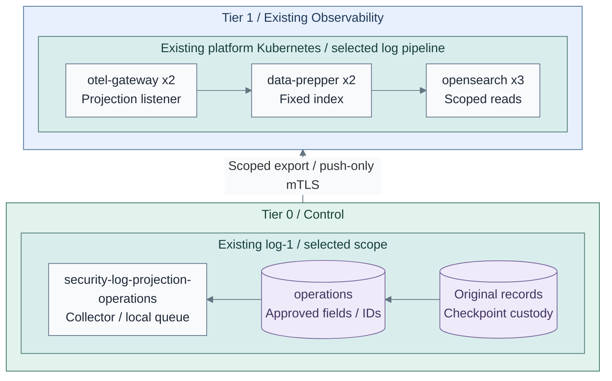

# Protected-log search copies

**Working repositories:** `<prefix>-tier-0` publishes and exports approved copies;
`<prefix>-tier-1` owns the existing authenticated ingestion and search workloads.
Original evidence, NAS retention and backup authority remain in Tier 0.

**Prerequisites:** accepted [logging checkpoints](../stage-2-logging/step-3c-nas-archive.md),
an approved source catalogue, and [projection ingestion](configuration.md#approved-search-projections).

## Contents

- [Step 1: Approve a copy](#step-1-approve-a-copy)
- [Step 2: Install the scoped exporter](#step-2-install-the-scoped-exporter)
- [Step 3: Verify access and recovery](#step-3-verify-access-and-recovery)



**IaC:** Tier 0's [checkpoint publisher](../../../tier-0/ansible/roles/logging_archive/)
creates the approved files; its [export recipe](../../../tier-0/ansible/playbooks/deployment/logging-export.yml)
installs one container per selected scope using the [local inputs](../../../tier-0/ansible/group_vars/logging_export.yml.example).
Tier 1's [existing pipeline](../../../tier-1/ansible/roles/observability_platform/templates/collector-config.yml.j2)
selects the destination by authenticated listener, never a producer-supplied scope label.
This figure covers one new `operations` export on `log-1`, not the entire logging or Observability stack.
Arrows show checkpoint filtering, the read-only copy mount, push-only scoped mTLS and indexing,
in that order. Query access remains in [Stage 8's reader view](README.md#step-4-publish-and-verify-read-only-views).

## Step 1: Approve a copy

In Tier 0's local `ansible/group_vars/logging_archive.yml`, select exact sources,
reader group, approval record and fields:

```yaml
logging_archive_projections:
  operations:
    group: log-export
    approval: SEC-001
    sources: [pve01]
    fields: [source, source_tier, received_at, reported_host]
    content_approved: false
```

Replace `pve01` with a source already registered in the receiver-owned catalogue.
`raw` and `message` are excluded unless explicitly selected with
`content_approved: true`; review their entire content, not only their field names.
This is field filtering, not automatic secret detection or semantic redaction.
Reapply the [archive recipe](../stage-2-logging/step-3c-nas-archive.md) using its existing inputs.
Only newly checkpointed records enter a newly added scope. Historical backfill requires a separately reviewed
offline export; never reset the original checkpoint cursor to create a search copy.

Changing an existing scope's policy requires a new scope name and a new reader/ingestion review.
Create-only publication rejects conflicting content; it does not overwrite prior exports.
Each record has a stable event ID and policy hash. Retries can still produce duplicate search documents;
event IDs support reconciliation, not an exactly-once claim.
The selected Data Prepper pipeline decodes the OTLP JSON body and its approved `record`
object for field queries such as `body.record.source`. Investigate
`projection_record_parse_failure` tags; this parsing never changes the listener-selected index. [3]

## Step 2: Install the scoped exporter

1. In Tier 1's Observability inputs, define a matching `kind: projection` scope with
   its dedicated client CA, NodePort and authorized `reader_backend_roles`.
2. Prepare a client certificate for this scope and a verified gateway hostname.
   The certificate must chain to that listener's client CA, not a general application CA.
3. Copy the Tier 0 `logging_export.yml.example` to local `logging_export.yml`.
   Set its endpoint and external credential paths; approve only that destination in the firewall.

From Tier 0, after the first approved files exist:

```bash
ansible-playbook -i ansible/inventory/hosts.yml ansible/playbooks/deployment/logging-export.yml -e @ansible/group_vars/logging_export.yml
```

The role installs a non-root native Collector using Podman Quadlet. Each container mounts only its
selected copy directory read-only, its own credentials and writable local queue/cursors. It cannot
mount original evidence, call a Tier 0 archive API or delete the approved files. [1][2]
No batching processor is used before the persistent exporter queue. The queue and offsets share
explicit local custody; this is bounded asynchronous delivery, not replicated intake.
SELinux relabelling applies only to the derived copy directory and the exporter's own state.

## Step 3: Verify access and recovery

| Check | Expected result |
| --- | --- |
| Known source event | Original remains intact; only selected fields appear in its authorized index |
| Producer-forged scope | Cannot select another listener/index or broaden the approved fields |
| Reader denial | Another role cannot query the scope; direct original/archive access is denied |
| Gateway outage/restart | Local cursor/queue survives and replays within the measured storage budget |
| Scope removal | Reapply a nonempty retained scope list to stop/remove retired export units; revoke its client credential and firewall grant |
| Last scope removal | Select an empty scope list with `logging_export_retire_all: true`, revoke its certificate/egress and remove the publication policy; accidental empty lists fail closed |
| Restore | Restore originals independently; search copies can be rebuilt only through an approved export |

Monitor queue, disk, certificate expiry and source-to-index age independently. No original or derived
file retention/pruning is installed by the exporter. Capacity and retention remain deliberate operator work.
Removing read access cannot retract copies already indexed or downloaded: apply the selected Tier 1
retention/deletion policy separately. Tier 1 index maintenance never changes Tier 0 originals.

Return to [Stage 8, Step 4](README.md#step-4-publish-and-verify-read-only-views).

## References

1. [OpenTelemetry filelog receiver](https://github.com/open-telemetry/opentelemetry-collector-contrib/tree/main/receiver/filelogreceiver).
2. [OpenTelemetry persistent file storage](https://github.com/open-telemetry/opentelemetry-collector-contrib/tree/main/extension/storage/filestorage).
3. [Data Prepper native JSON parsing](https://docs.opensearch.org/latest/data-prepper/pipelines/configuration/processors/parse-json/).
