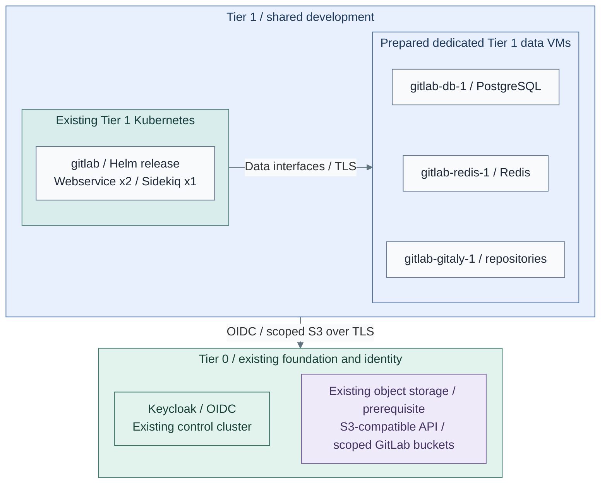
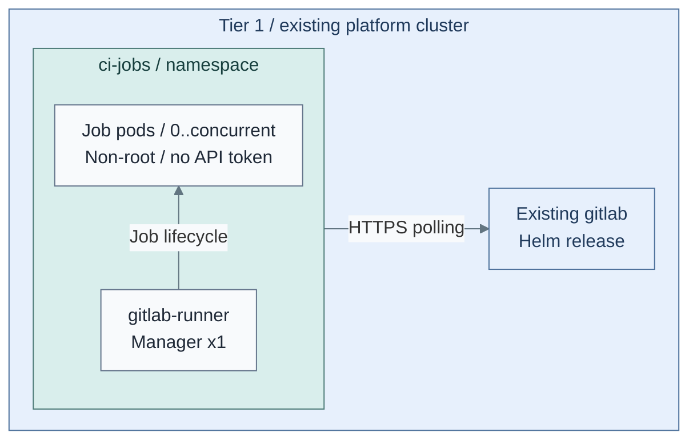
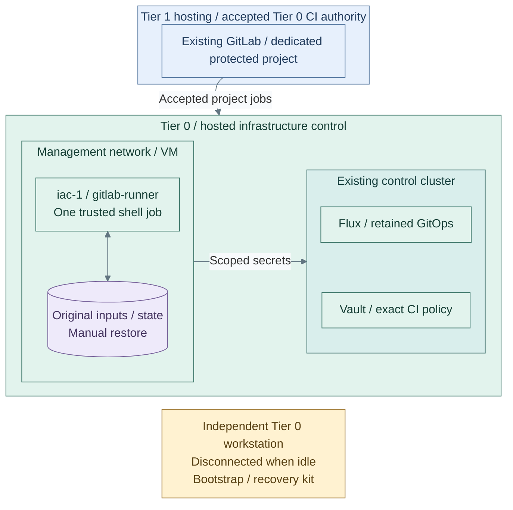

# Stage 9: Development platform

Deploy source control and CI, then transfer routine infrastructure execution from
the bootstrap workstation. The reference uses GitLab on Tier 1 Kubernetes,
on-demand Kubernetes job pods and a separate Tier 0 infrastructure runner.

**Prerequisites:** accepted Delivery, Observability, Identity and Secrets;
prepared GitLab data services, TLS, backups and independent recovery material.
**Working repositories:** `<prefix>-tier-1` for GitLab/general CI and
`<prefix>-tier-0` for Vault CI policy and the infrastructure runner.
**Automation:** native Helm installation/rendering, a runner VM/role and Vault JWT
policy are supplied. Data-service commissioning, live acceptance and automated lab
requests remain separate; see [coverage](../../reference/implementation-support.md#stage-coverage).
**Design:** [development platform](../../architecture/delivery/development-platform.md).

## Main path

1. [Deploy source control and SSO](#step-1-deploy-source-control-and-sso)
2. [Add on-demand build execution](#step-2-add-on-demand-build-execution)
3. [Authorize CI through Vault](#step-3-authorize-ci-through-vault)
4. [Hand over infrastructure execution](#step-4-hand-over-infrastructure-execution)

## Step 1: Deploy source control and SSO

Follow [GitLab Kubernetes installation](procedures/gitlab.md), including external
[dedicated PostgreSQL, Redis and Gitaly VMs](procedures/data-services.md), scoped
object-storage buckets and the Keycloak client. Tier 1 owns its data and credentials;
the selected Tier 0 object-storage service owns the underlying storage interface.

**IaC:** Tier 1 [inputs](../../../tier-1/ansible/group_vars/development_platform.yml.example),
[recipe](../../../tier-1/ansible/playbooks/deployment/development-platform.yml)
and [values template](../../../tier-1/ansible/roles/development_platform/templates/gitlab-values.yml.j2).
The GitLab box aggregates the native chart; its labels highlight web/worker scale,
not a complete pod inventory. The dedicated data VMs are prepared by the separate
[data-service recipe](procedures/data-services.md); this step then installs GitLab.
The selected object-storage service already exists and supplies tenant credentials,
never storage-admin authority. This stage deploys no storage VM or gateway.
A NAS file mount cannot replace the chart's object API requirement.
Accept SSO, scoped membership, clone/push and
backup/restore before ordinary use.
**Alternative:** [1b: source-control VM](step-1b-source-control-vm.md).

**Result:** accepted source control with SSO and independently recoverable data.

## Step 2: Add on-demand build execution

Follow [Kubernetes runners](procedures/kubernetes-runners.md). One manager creates
an ephemeral pod per accepted job. This scales job pods, not worker VMs.

**IaC:** Tier 1 [runner values](../../../tier-1/ansible/roles/development_platform/templates/runner-values.yml.j2)
and [identity/network policy](../../../tier-1/ansible/roles/development_platform/templates/runner-support.yml.j2).
Jobs have no Tier 0 credentials. Test actual policy enforcement, denied API access
and cleanup after failure. Untrusted builds may require dedicated nodes or clusters.
**Alternatives:** [2b: Podman](step-2b-podman-runner.md) and
[2c: image-based Linux](step-2c-image-based-linux.md).

**Result:** bounded build jobs run without infrastructure credentials.

## Step 3: Authorize CI through Vault

Follow [Vault CI authentication](procedures/vault-ci.md). Tier 0 creates the
`gitlab-ci` JWT backend and exact project/namespace/protected-branch roles.
Human SSO uses Keycloak; CI uses GitLab-signed ID tokens. These are separate
issuers and authorization paths.

**IaC:** Tier 0 [CI auth root](../../../tier-0/terraform/deployments/ci-auth/)
and [inputs](../../../tier-0/terraform/deployments/ci-auth/terraform.tfvars.example).
The root creates policies, not Vault or secret values. Test denied audiences,
projects and branches before storing infrastructure credentials in the permitted path.

**Result:** only the accepted project and protected branch obtain the scoped CI secret.

## Step 4: Hand over infrastructure execution

Direct CI explicitly trusts the dedicated project, GitLab administrators and
administrators able to alter its hosting at Tier 0. General projects and delivery
controllers remain unprivileged. This differs from independently authorized requests.

**IaC:** Tier 0 [runner root](../../../tier-0/terraform/deployments/infrastructure-runner/),
[installation](../../../tier-0/ansible/playbooks/deployment/infrastructure-runner.yml)
and [CI example](../../../tier-0/ci/gitlab-iac.yml.example).
Follow [runner preparation](procedures/infrastructure-runner.md), then
[original-state handover](procedures/handover.md). The workstation is outside the
hosted runtime, not outside Tier 0 trust; it is online while operating.

**Result:** the dedicated runner applies reviewed plans against the original state;
the independent workstation remains available for recovery.

## Capability available

GitLab provides SSO-backed source control, general CI uses disposable Tier 1 pods,
and reviewed IaC uses the explicitly trusted Tier 0 path. Accept handover only
after state continuity, denied-job checks, secret cleanup, logging and independent
recovery are demonstrated. Continue with [Stage 10: Lab environments](../stage-10-lab-environments/README.md).
