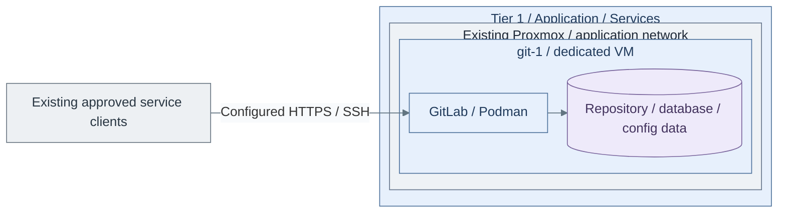

# Step 1b: Source control on a VM

**Working repository:** `<prefix>-tier-1` (source: `tier-1/`).
Run repository scripts from this root; paths below are repository-relative.

<a id="development-platform-path"></a>

**Branch from:** [Step 1](README.md#step-1-deploy-source-control-and-sso), instead of deploying source control in the Tier 1 cluster.
**Change:** Use the VM service deployment without changing runner authority.
**Return:** [Step 1 acceptance](README.md#step-1-deploy-source-control-and-sso), then Step 2 runner selection.

**Design:** [delivery service variants](../../architecture/software/README.md).

## Table of contents

- [Purpose](#purpose)
- [Prerequisites](#prerequisites)
- [What this deploys](#what-this-deploys)
- [IaC used for this](#iac-used-for-this)
- [Configure the deployment](#configure-the-deployment)
- [Ports and DNS](#ports-and-dns)
- [Operations](#operations)
- [High availability direction](#high-availability-direction)
- [Read more](#read-more)
- [References](#references)

## Purpose

Use this path when the private cloud needs source control, CI/CD coordination,
and a starting point for internal software projects.

The reference implementation is GitLab on one dedicated Podman VM. This keeps
the source-control runtime separate from the existing Tier 1 cluster and Stage 7 registry.
Runner selection follows at Step 2; image builds are an optional extension there.

<a id="before-you-start"></a>

## Prerequisites

Have these in place first:

| Requirement | Why it matters |
| --- | --- |
| Identity foundation | Accepted Keycloak and private-domain DNS; OIDC configuration is a project-owned integration before ordinary use. |
| PKI certificate | The default deployment expects HTTPS with a certificate from the shared PKI. |
| Linux template | Terraform clones the normal Linux cloud-init template. |
| Backup target | Repository and database data live on the VM and must be backed up before the platform matters. |

## What this deploys



**IaC:** Tier 1 [VM inputs](../../../tier-1/terraform/deployments/development/terraform.tfvars.example)
and [source-control recipe](../../../tier-1/ansible/playbooks/deployment/source-control-vm.yml).
This creates one service VM; runners, registry alternatives and public edge are separate deployments.

Default deployment:

| Role | Default host | Default count | Notes |
| --- | --- | --- | --- |
| development platform | `git-1` | `1` | Podman host running the GitLab container |

Default VM shape:

| Setting | Default |
| --- | --- |
| size | `xl` |
| disk | `200 GB` |
| storage class | `shared` |
| network zone | `application` |

This path does not deploy runners by default. Use the
[Podman image runner guide](step-2b-podman-runner.md) when build jobs should run away
from the GitLab host.

## IaC used for this

| Repository | Layer | Path inside that repository |
| --- | --- | --- |
| Tier 1 | Terraform setup | [terraform/deployments/development/](../../../tier-1/terraform/deployments/development); local `terraform.tfvars` |
| Tier 1 | Ansible inventory | `ansible/inventory/hosts.yml` |
| Tier 1 | Ansible environment vars | `ansible/group_vars/all.yml` or `all.<env>.yml` |
| Tier 1 | Ansible setup vars | `ansible/group_vars/development.yml` |
| Tier 1 | Deployment recipe | [ansible/playbooks/deployment/source-control-vm.yml](../../../tier-1/ansible/playbooks/deployment/source-control-vm.yml) |
| Tier 1 | Service role | [ansible/roles/gitlab_container/](../../../tier-1/ansible/roles/gitlab_container) |
| Shared | Host baseline | [ansible/roles/baseline/](../../../shared/ansible/roles/baseline) |
| Shared | Execution helper | [scripts/deploy.sh](../../../shared/scripts/deploy.sh); called by Tier 1's `scripts/deploy.sh` |

## Configure the deployment

### 1. Create local inputs

Run from **`<prefix>-tier-1/`**.

```bash
bash scripts/init-local-files.sh --setup development
```

### 2. Edit these files

Edit in **`<prefix>-tier-1/`**.

- `terraform/deployments/development/terraform.tfvars`: `vm_instances.git-1`: unused VMID, size,
  `disk_size_gb`, `storage_class`, `network_zone_key`
- `ansible/inventory/hosts.yml`: Matching git-1 key and service group
- `ansible/group_vars/development.yml`: `platform_host_ips.git-1`, `gitlab_container_image`,
  `gitlab_hostname`, `gitlab_external_url`, `gitlab_tls_cert_src`, `gitlab_tls_key_src`,
  `gitlab_ssh_host_port`, `gitlab_omnibus_extra_config`
- `.env.local`: Tier 1 provider credentials and local SSH public-key paths

Use an approved CE image tag/digest and a preissued certificate/chain/key. Prepare
scoped gateway/host rules before publishing listeners. Register the Keycloak client, then supply its
[native GitLab OIDC settings](https://docs.gitlab.com/administration/auth/oidc/) through
`gitlab_omnibus_extra_config`, one `gitlab.rb` line per list item, with an accepted private client-secret input. [5]
The role renders that input; no template edit is needed. Editing the rendered VM file alone will be overwritten.
The OIDC settings remain project-supplied, not a turnkey configuration from this recipe.
Qualify this project integration through the [service SSO gate](../stage-5-identity/procedures/service-sso.md)
before accepting ordinary use.

### 3. Deploy and verify

Run from **`<prefix>-tier-1/`**.

```bash
bash scripts/deploy.sh development
```

Review Terraform's inline plan and enter `yes` only for the intended changes.
Add `--plan-only` for preview; approved unattended jobs use `--auto-approve`.

For the first login, retrieve the temporary administrator password on **`git-1`** with authorized
container access, then sign in at the configured HTTPS hostname:

```bash
sudo podman exec -it gitlab grep 'Password:' /etc/gitlab/initial_root_password
```

Rotate/store the new administrator credential through the accepted secret path. Complete the
project-owned OIDC configuration and its live SSO gate before accepting ordinary users.
Verify HTTPS, SSO/denials, clone/push, protected logging and clean-target recovery,
then return to [Stage 9 Step 1 acceptance](README.md#step-1-deploy-source-control-and-sso).
Continue with Step 2's runner selection; the Kubernetes/data-VM installers are not part of this alternative.

For a separate test installation, follow [environment isolation](../../reference/repository-scripts.md#environment-isolation)
and add `--env test` consistently to initialization/deployment. Test and production
need different VMIDs, addresses and full Terraform guest maps; omitting `--env` is
not a promotion or migration of test state.

## Ports and DNS

Publish these ports to users or to the edge proxy, depending on the network
design:

| Port | Purpose |
| --- | --- |
| `80/tcp` | HTTP redirect and GitLab internal web handling |
| `443/tcp` | HTTPS web UI and Git over HTTPS |
| `2222/tcp` | Git over SSH, mapped to container port `22` |

Use the DNS name from `gitlab_external_url`. Do not use `localhost` as the
GitLab hostname.
Apply scoped gateway and host-firewall rules through the
[firewall rollout](../foundation/network/firewall.md); container port
publication and the Shared baseline do not install those rules.

## Operations

Persistent data is mounted under `gitlab_home`, default `/srv/gitlab`:

| Host path | Container path | Purpose |
| --- | --- | --- |
| `/srv/gitlab/config` | `/etc/gitlab` | GitLab configuration and TLS files |
| `/srv/gitlab/logs` | `/var/log/gitlab` | GitLab logs |
| `/srv/gitlab/data` | `/var/opt/gitlab` | repositories, database, uploads, and runtime data |

Maintenance notes:

- Back up `/srv/gitlab` before upgrades.
- Pin the GitLab image tag before production use.
- Keep runners on separate hosts when build workloads become noisy.
- Send OS/security/audit events to [Tier 0 protected logging](../stage-2-logging/sources.md)
  from installation; do not wait for Observability. Operational application logs
  and metrics later use [Stage 8](../stage-8-observability/README.md) under approved scopes.

## High availability direction

This alternative is a single GitLab VM, not the default Kubernetes realization.
Accept its outage limits and product-level backup/restore independently.

The [Kubernetes installer](procedures/gitlab.md) separates application compute
from managed data services. Migration requires a deliberate product-data restore
and one deployment owner; multiple pods alone do not establish HA.

Do not scale this by starting several independent GitLab containers. Moving to the
Kubernetes alternative needs shared stateful services and the GitLab cloud-native
deployment model, plus the deliberate migration above.

## Read more

- [Development platform](README.md)
- [Podman image runner guide](step-2b-podman-runner.md)
- [Container registry path](../stage-7-delivery/procedures/registry.md)
- [Kubernetes platform path](../stage-7-delivery/procedures/platform-cluster.md)
- [Shared services model](../../architecture/service-boundaries.md)
- [Infrastructure automation layout](../../development/code-layout.md)
- [Repository scripts](../../reference/repository-scripts.md)

## References

1. [GitLab Docker installation](https://docs.gitlab.com/install/docker/installation/)
2. [GitLab Docker configuration](https://docs.gitlab.com/ee/install/docker/configuration.html)
3. [GitLab SSL configuration](https://docs.gitlab.com/omnibus/settings/ssl/)
4. [GitLab Helm chart installation](https://docs.gitlab.com/charts/installation/)
5. [GitLab OpenID Connect provider configuration](https://docs.gitlab.com/administration/auth/oidc/), checked 2026-11-09.
