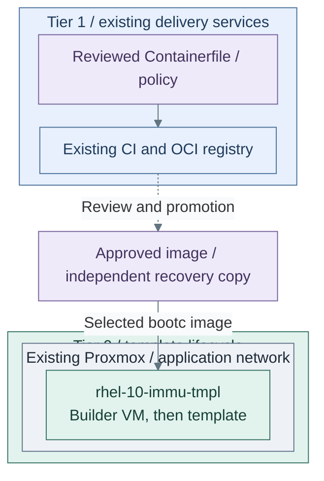

# Step 2c: Image-based Linux

**Working repository:** `<prefix>-tier-0` (source: `tier-0/`) for image builders.
Run repository scripts from this root; Tier 1 consumers keep their own workload definitions.

<a id="image-based-linux-path"></a>

**Branch from:** [Step 2](README.md#step-2-add-on-demand-build-execution), when choosing the Tier 1 host lifecycle.
**Change:** Use image-based hosts while Tier 0 retains template ownership.
**Return:** [Step 3](README.md#step-3-authorize-ci-through-vault) for secret integration before infrastructure handover.

**Design:** [guest and image lifecycle variants](../../architecture/hosting/README.md).

**Coverage:** the supplied role prepares a builder and can request `bootc switch`; it does not
perform an initial bootc OS installation. A normal Alma/Rocky/RHEL cloud image is not converted
just by installing the `bootc` package. Initial installation and compatibility qualification are
project integration; stop at the explicit gate below until they are complete. [8]

## Table of contents

- [Purpose](#purpose)
- [What image-based means](#what-image-based-means)
- [Security posture](#security-posture)
- [Dependency model](#dependency-model)
- [What this deploys](#what-this-deploys)
- [Reference workflow](#reference-workflow)
- [Template conversion flow](#template-conversion-flow)
- [Distro support](#distro-support)
- [Operating model](#operating-model)
- [Read more](#read-more)
- [References](#references)

## Purpose

Use this path to manage Linux servers from versioned
operating-system images instead of ad hoc package changes on each host.

The repository reference implementation is `bootc` for Fedora and Enterprise
Linux-like systems: build a bootable OCI image, publish it to a registry,
deploy or convert hosts to that image, and update the host by moving to a newer
image.

## What image-based means

Immutable Linux is a common shorthand, but image-based Linux is the more precise
term for this path. The whole machine is not read-only. The base operating
system comes from a versioned image and changes through image updates instead
of manual package changes on each host.

With image mode for RHEL, the root filesystem is immutable by default except
for `/etc` and `/var`, and most content comes from the container image.[1]
bootc applies the container image as the bootable host operating system; after
deployment, systemd still runs as normal and the system is not running inside an
outer container.[2]

## Security posture

Image-based Linux improves the platform security posture by reducing drift and
making the operating system an artifact.

| Benefit | Security effect | Still required |
| --- | --- | --- |
| image-based OS | every host can be traced back to a built image | image signing, scanning, and promotion rules |
| transactional updates | failed updates can roll back | maintenance windows and reboot handling |
| reduced host mutation | fewer package changes and snowflake hosts | separate handling for `/etc`, `/var`, secrets, and data |
| CI-built images | hardening changes go through review | protected branches, runners, and registry controls |
| registry-based delivery | updates can be promoted by tag or digest | registry availability, pull credentials, and retention policy |

This does not replace hardening. Identity, secrets, logging,
backup, endpoint hardening, and incident response remain necessary. Immutable hosts make the
base system easier to reproduce and reason about; they do not make runtime
compromise impossible.

## Dependency model

The `immutable-template` setup belongs to Tier 0 because it creates images
used by other systems. Its builder consumes approved images with a local
recovery copy; a live Tier 1 registry or runner must not be required to rebuild
it. General build services can prepare candidates, but acceptance and privileged
publication remain protected at Tier 0. Offline custody uses separate transfers.
See [Template lifecycle](../../administration/virtual-machines/template-lifecycle.md).

Harbor is not required to start with bootc. The first useful internal path can
run during the GitLab stage by using a dedicated GitLab runner and GitLab's
built-in registry.

| Mode | Requirements | Use case |
| --- | --- | --- |
| standalone pilot | local build host and temporary registry or image source | initial evaluation of the model |
| GitLab-stage path | GitLab, a bootc runner, and GitLab registry | automated internal OS image builds before Kubernetes |
| shared registry path | GitLab CI/CD plus Harbor registry | scanning, promotion, and private update delivery across platforms |
| hardened production path | signed images, protected tags, staged rollout, rollback tests | bootc becomes the normal server lifecycle |

Red Hat image mode docs list a container registry as a prerequisite, and bootc
docs note that private registries are common for fleets.[1][3] A local or
external registry can satisfy that prerequisite for a pilot. GitLab's built-in
registry is enough for the first internal bootc builds. Harbor is the repo
reference for the later shared registry stage.

## What this deploys

This path has a dedicated template-builder setup:

The deployment setup is named `immutable-template` because it creates reusable
Proxmox templates for immutable or image-based Linux hosts. The guide keeps the
broader name "image-based Linux" because bootc is the current implementation,
not the only possible model.

| Repository | Path inside that repository | Responsibility |
| --- | --- | --- |
| Tier 0 | [terraform/deployments/immutable-template/](../../../tier-0/terraform/deployments/immutable-template); local `terraform.tfvars` | Temporary template-builder VM |
| Tier 0 | `ansible/inventory/hosts.yml` | Stable `immutable_template_builders` host group |
| Tier 0 | `ansible/group_vars/immutable_template.yml` | bootc image, registry auth, CA trust and cleanup |
| Tier 0 | [ansible/roles/immutable_template/](../../../tier-0/ansible/roles/immutable_template) | bootc tooling and preparation for template conversion |
| Shared | [ansible/roles/baseline/](../../../shared/ansible/roles/baseline) | Common host preparation |
| Shared | [scripts/deploy.sh](../../../shared/scripts/deploy.sh) | Execution helper called from Tier 0's root |

The default is one builder VM named for the target template,
`rhel-10-immu-tmpl`. The builder starts as a normal VM so Ansible can configure
and verify it. Convert it to a Proxmox template only after the bootc image and
rollback behavior are tested.

## Reference workflow



**IaC:** Tier 0 [builder inputs](../../../tier-0/terraform/deployments/immutable-template/terraform.tfvars.example)
and [builder recipe](../../../tier-0/ansible/playbooks/deployment/immutable-template.yml).
The same guest becomes a template after explicit verification; this does not create workload clones.
CI/image publication is an existing prerequisite or project integration, not installed by the builder recipe.

Figure: this workflow uses GitLab for the build and initial registry. Harbor is
an optional promotion destination, not a required next stage. Other approved
sources follow the selected [artifact-supply design](../../architecture/software/artifact-supply.md).
Dashed lines mark approval boundaries, not implicit live access. Custody uses
offline transfer; host updates remain separate. The [Podman runner procedure](step-2b-podman-runner.md)
supplies the first build host.

## Template conversion flow

Keep builder preparation, initial OS installation, image switching and final template conversion
separate. The role executes package tasks and optional switching; a successful preparation run
does not prove that the VM is booted from an image.

### 1. Initialize the isolated builder inputs

Run from **`<prefix>-tier-0/`**.

```bash
bash scripts/init-local-files.sh --setup immutable-template --env test
```

### 2. Select the source and prepare the builder

In **`<prefix>-tier-0/`**, complete
[environment isolation](../../reference/repository-scripts.md#environment-isolation):

- `terraform/deployments/immutable-template/terraform.test.tfvars`: create the complete test map
  from the base inputs, with a unique VMID, approved source image, `template = false` and `started = true`.
  The initializer does not create this Terraform overlay.
- `ansible/inventory/hosts.yml`: the matching `immutable_template_builders` host key.
- `ansible/group_vars/immutable_template.test.yml`: its reserved IP, approved image reference,
  registry CA/auth paths and supported packages. The test file overrides the base vars.
  Keep `immutable_template_apply_bootc: false` and `immutable_template_prepare_for_template: false`.

Keep the builder in its original state throughout. Prepare it from **`<prefix>-tier-0/`**:

Run from **`<prefix>-tier-0/`**.

```bash
bash scripts/deploy.sh immutable-template --env test
```

Review Terraform's inline plan and enter `yes` only for the intended changes.
`--plan-only` previews; `--auto-approve` is for approved CI. This pass prepares tools/trust,
not a bootc deployment. The role tolerates a failed initial `bootc status` probe.

### 3. Qualify the missing initial-installation step

**Stop for an ordinary cloud-image builder.** Complete a distro-supported initial bootc installation
or use a separately commissioned bootc-native source image. That installation is not implemented
by this recipe; do not substitute `bootc switch` for it. [8]

Before continuing, verify the selected guest is bootc-native and compatible with the role's
package/preparation tasks. Ensure its image already supplies required packages where runtime package
installation is unavailable. Retain recoverable data and an independently tested rollback path.

### 4. Stage and boot a qualified image

Only after Step 3, in **`<prefix>-tier-0/ansible/group_vars/immutable_template.test.yml`**, select
the approved `immutable_template_bootc_image`, set `immutable_template_apply_bootc: true` and
explicitly select `immutable_template_reboot_after_switch: true` for the accepted reboot window.
Keep cleanup disabled. Run from **`<prefix>-tier-0/`**:

```bash
bash scripts/deploy.sh immutable-template --env test --ansible-only
```

On **the builder VM**, verify the booted image, not just a staged deployment:

```bash
sudo bootc status
```

Verify SSH, cloud-init and the intended update/rollback behavior before proceeding.
The role's status output alone is not a rollback rehearsal.

### 5. Clean the verified candidate

In **`<prefix>-tier-0/ansible/group_vars/immutable_template.test.yml`**, enable:

```yaml
immutable_template_prepare_for_template: true
```

Run from **`<prefix>-tier-0/`**, while the builder remains a running VM:

```bash
bash scripts/deploy.sh immutable-template --env test --ansible-only
```

Require successful cleanup before shutdown; it removes machine-specific cloud-init/SSH state.
Do not treat ignored probe failures as proof of a clone-ready image.

### 6. Convert the candidate and test a clone

In **`<prefix>-tier-0/terraform/deployments/immutable-template/terraform.test.tfvars`**, set
that builder to `template = true` and `started = false`. Run only Terraform for final conversion:

Run from **`<prefix>-tier-0/`**.

```bash
bash scripts/deploy.sh immutable-template --env test --terraform-only
```

The BPG Proxmox provider supports converting a VM to a template by setting the
VM resource `template` attribute to `true`. Converting a template back to a
normal VM is not supported, so treat this as a one-way finalization step.[7]

Create a disposable clone and verify unique machine/SSH identities, intended cloud-init behavior,
image boot, update and rollback. Only then publish its actual VMID/source metadata in
**`<prefix>-shared/templates/proxmox-catalog.tfvars`** and select it for consumers.
`template_catalog_id` is metadata selection; it does not perform the bootc installation.

For private bootc registries, place pull credentials where bootc can read
them. bootc documents `/etc/ostree/auth.json` as the private registry auth
location.[3]

Initial bootc installation remains a prerequisite to image switching in this path. For larger scale, prefer
building disk images directly from the bootc image with the distro-supported
image tooling when that path is ready for the environment.

**Return:** [Stage 9, Step 3](README.md#step-3-authorize-ci-through-vault), or defer this optional
image-lifecycle integration and continue there without converting a template.

## Distro support

Do not assume every Enterprise Linux-like distro has the same image-based Linux
maturity.

| Distro family | Current guidance |
| --- | --- |
| RHEL | reference enterprise path for image mode and `rhel-bootc` images |
| Fedora | useful upstream and fast-moving bootc path, especially for testing |
| AlmaLinux | experimental bootc images exist; validate support before production |
| Rocky Linux | verify current upstream bootc image availability before use |
| CentOS Stream or SIG images | useful for experimentation when the specific SIG image matches the use case |

Keep separate templates for each OS and major release. When keeping both mutable
and image-based templates, use names such as `alma-10-tmpl` and
`alma-10-immu-tmpl` so the lifecycle is visible before a VM is cloned.

## Operating model

Use these rules for production bootc hosts:

- rebuild images on a schedule and when base image updates are published
- scan images before promotion
- promote by explicit tag or digest instead of treating `latest` as production
  policy
- stage updates with maintenance windows for critical services
- test rollback before broad rollout
- keep `/etc`, `/var`, secrets, and application data out of the base image
- keep pull credentials and registry trust material managed by the shared
  secret and PKI paths

bootc supports transactional upgrades and rollback. `bootc upgrade` queries
the image source and stages an updated image for the next boot, while rollback
keeps the previous deployment available.[4]

## Read more

- [Development platform](README.md)
- [Container registry path](../stage-7-delivery/procedures/registry.md)
- [Development platform path](step-1b-source-control-vm.md)
- [Podman image runner guide](step-2b-podman-runner.md)
- [Enterprise Linux template](../foundation/proxmox/templates.md)
- [Proxmox planning guidelines](../../conventions/proxmox-conventions.md)
- [Security principles](../../architecture/principles.md)

## References

1. [Red Hat image mode for RHEL](https://docs.redhat.com/en/documentation/red_hat_enterprise_linux/10/html/using_image_mode_for_rhel_to_build_deploy_and_manage_operating_systems/introducing-image-mode-for-rhel)
2. [bootc introduction](https://bootc.dev/bootc/)
3. [bootc registries and disconnected updates](https://bootc.dev/bootc/registries-and-offline.html)
4. [bootc upgrades and rollback](https://bootc.dev/bootc/upgrades.html)
5. [Fedora/CentOS bootc base images](https://fedora.gitlab.io/bootc/docs/bootc/base-images/)
6. [AlmaLinux bootc images](https://github.com/AlmaLinux/bootc-images)
7. [BPG Proxmox provider VM template conversion](https://github.com/bpg/terraform-provider-proxmox/blob/main/docs/resources/virtual_environment_vm.md)
8. [bootc image switching](https://bootc.dev/bootc/man/bootc-switch.8.html) and
   [initial installation into an existing root](https://bootc.dev/bootc/man/bootc-install-to-existing-root.8.html),
   checked 2026-11-09. Initial installation has separate destructive/storage/configuration requirements.
