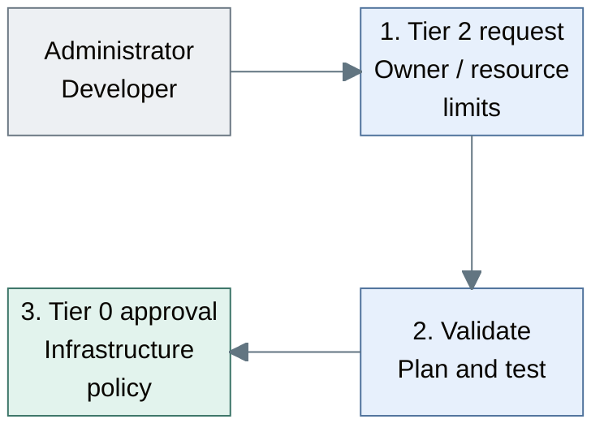
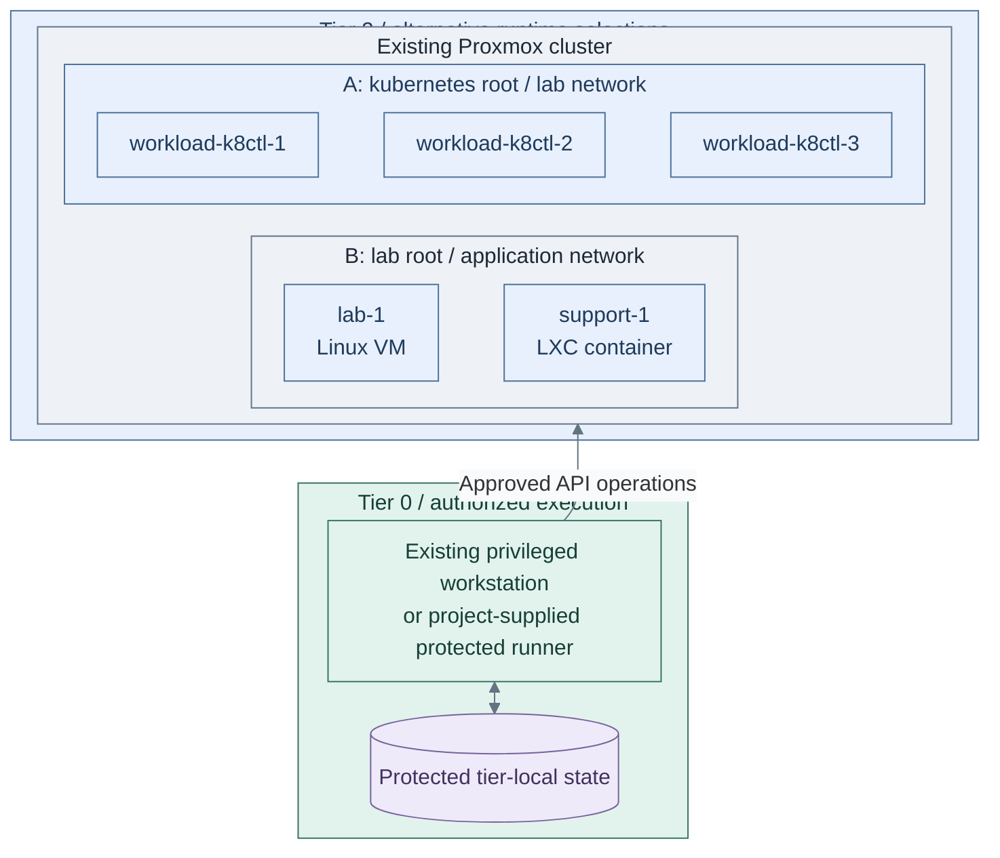
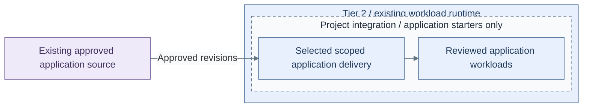

# Stage 9: Workload provisioning

Provide a repeatable, approved workflow for Tier 2 VMs and applications. Requests are
validated and authorized before infrastructure execution; workload GitOps remains
separate from hypervisor and cluster lifecycle authority.

**Prerequisites:** accepted [delivery and protected execution](../stage-7-delivery/README.md),
accepted [Observability interfaces](../stage-8-observability/README.md), scoped
credentials, protected state and tested recovery.
**Working repositories:** `<prefix>-tier-2` for workload definitions;
`<prefix>-tier-0` for privileged execution (source: matching `tier-N/`).
**Automation:** tier-local guest and cluster lifecycle workflows are supplied;
application manifests and the protected request controller remain project integration.
See [coverage](../../reference/implementation-support.md#stage-coverage).

## Working repositories

| Work | Repository | IaC location inside that repository |
| --- | --- | --- |
| VM and workload definitions | `<prefix>-tier-2` | [terraform/deployments/lab/](../../../tier-2/terraform/deployments/lab/), [ansible/](../../../tier-2/ansible/) and [workloads/](../../../tier-2/workloads/) |
| Workload cluster | `<prefix>-tier-2` | [terraform/deployments/kubernetes/](../../../tier-2/terraform/deployments/kubernetes/) and [clusters/tier2/](../../../tier-2/clusters/tier2/) |
| Privileged request execution | `<prefix>-tier-0` | Project integration; no complete request controller is supplied |

Run local operator commands from Tier 2's root. Tier 0 execution does not move
these definitions, inventory or state into Tier 0 or Shared.

## Main path

1. [Define the approved request](#step-1-define-the-approved-request)
2. [Provision the workload runtime](#step-2-provision-the-workload-runtime)
3. [Deploy and verify applications](#step-3-deploy-and-verify-applications)

## Step 1: Define the approved request

Start with reviewed operator-driven jobs. Automatic self-service is an optional
implementation of the same bounded contract, not a reason to give general CI credentials.



**Workflow:** reviewed request handling, not a deployed controller.
Tier 2 [workload inputs](../../../tier-2/terraform/deployments/lab/terraform.tfvars.example)
feed a [Shared plan executor](../../../shared/scripts/deploy.sh); automated Tier 0 authorization remains project integration.

1. Record the workload owner, permitted templates, sizes, networks and quotas in
   the [Tier 2 repository](../../paths/tier-2/README.md).
2. Validate the request and review its plan under the
   [provisioning contract](../../architecture/compute/provisioning.md).
3. Verify that accepted and rejected requests follow Tier 0 authorization. The
   bounded request interface is a target design, not a shipped controller.

**Result:** only requests inside the selected policy reach privileged execution.
Unimplemented automation is recorded as outstanding work, not treated as available.

## Step 2: Provision the workload runtime

The protected runner creates the approved resources using the owning tier's inputs
and state. Shared supplies reusable helpers, never workload inventory or resources.



**IaC:** Tier 2 [Kubernetes inputs](../../../tier-2/terraform/deployments/kubernetes/terraform.tfvars.example)
and [cluster entry point](../../../tier-2/scripts/kubernetes-cluster.sh), or
[VM/LXC inputs](../../../tier-2/terraform/deployments/lab/terraform.tfvars.example)
and [lab recipe](../../../tier-2/ansible/playbooks/deployment/lab-vms.yml).
A and B are independent roots, not one command that creates both; choose the required runtime.
The [Shared executor](../../../shared/scripts/deploy.sh) consumes Tier 2 inventory/state, never owns them.

1. Execute the reviewed tier-local definition and verify the intended network boundaries.
2. For a workload cluster, reuse the [common Kubernetes procedure](../stage-4-kubernetes/procedures/kubernetes.md)
   with the tier-local `terraform/deployments/kubernetes/` root and
   `bash scripts/kubernetes-cluster.sh init`. The current installer uses Talos;
   it does not deploy applications, policies or an autoscaler.
3. Verify runtime readiness, state locking and independent restoration before workloads.

For the operator-driven VM/LXC path, initialize from the Tier 2 repository root:

```bash
bash scripts/init-local-files.sh --setup lab
```

Edit local `terraform/deployments/lab/terraform.tfvars`, inventory and
`ansible/group_vars/lab.yml` together. With authorized execution credentials, plan:

```bash
bash scripts/deploy.sh lab --plan-only
```

Review the complete resource plan before `bash scripts/deploy.sh lab`. These are
operator commands, not a command path that grants ordinary workload users Proxmox access.

**Result:** the [compute runtime](../../architecture/compute/README.md) is ready within
the workload's allocated scope, without changing Tier 0 ownership.

## Step 3: Deploy and verify applications

For an internet-facing website, follow the
[public HTTPS procedure](public-https.md): staging-first HTTP-01, verified private
origins, multi-node challenge serving and controller-owned renewal.

Follow the [workload collection deployment](telemetry.md), Steps 1-3:
security/audit submissions go to protected Tier 0 intake; developer views expose
only approved application logs in Tier 1. Local buffering does not imply local alerting.

Approved application revisions are reconciled inside the owning cluster. Rancher/Fleet
can manage selected Tier 1/2 clusters, never Tier 0 infrastructure.



**Integration:** Tier 2 [cluster starter](../../../tier-2/clusters/tier2/kustomization.yaml)
and [workload definitions](../../../tier-2/workloads/) receive project manifests.
Provisioning the runtime does not install the dashed application group or a delivery controller.

1. Select [scoped delivery](../../architecture/delivery/controllers.md) from Tier 1
   or an independently owned local controller. Deploy application manifests with
   workload-scoped permissions, namespaces, quotas, policies and service dependencies.
2. Exercise an update, rollback and restore, including the behavior when source control
   is unavailable. Source loss pauses new requests; it never authorizes deletion.
3. Hand recurring operations to [administration](../../administration/README.md), retaining
   independent recovery and separately authorized key ceremonies.

**Result:** application delivery works independently of privileged infrastructure
execution, as required by the [service boundaries](../../architecture/service-boundaries.md).

## Capability available

The platform can repeatedly deliver Tier 2 workloads through its approved workflow.
Record policy, recovery and acceptance evidence against
[readiness criteria](../readiness.md). Continue with administration for ongoing operation
and [development](../../development/README.md) for unimplemented automation.
