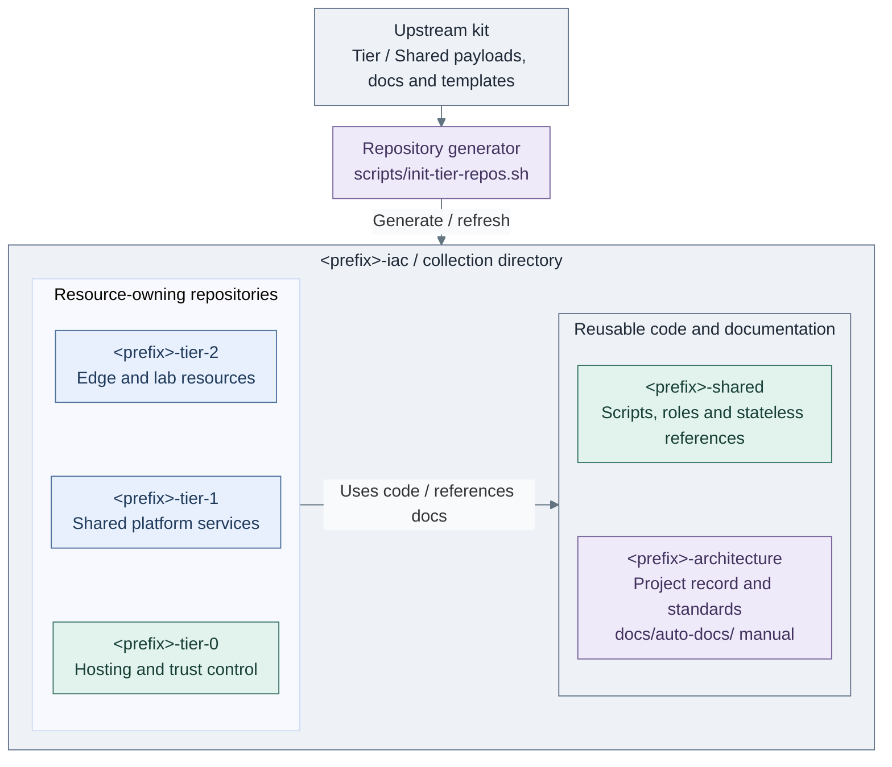

# Development

Start with the repository that owns the change. Follow its inputs, execution code
and checks; use the [architecture](../architecture/README.md) when changing a design boundary.

## Contents

- [Which repository?](#which-repository)
- [Where to edit](#where-to-edit)
- [Fast change loop](#fast-change-loop)
- [Exact references](#exact-references)

## Which repository?

The upstream kit supplies reusable code and examples. A generated collection holds
the private implementation and project decisions. Paths inside each tier remain
the same: upstream `tier-2/ansible/` becomes `<prefix>-tier-2/ansible/`.



**Code:** the upstream kit's `scripts/tier-repos/generate.py` and `payload.py`
implement the [generation contract](generated-repositories.md).
[Tier-local entry points](../../tier-2/scripts/deploy.sh) call Shared helpers.
This is a repository map,
not a network or deployment diagram. Inventory, resources and state stay tier-owned.
The collection directory is not itself a Git repository.

| Change | Edit in |
| --- | --- |
| Reusable fix or example for future projects | This upstream kit; verify generated output before publishing |
| Site names, IPs, guest sizes or application settings | The owning private tier repository |
| Common platform references or reusable role behavior | Shared; references may be project-owned, while managed code follows the refresh contract |
| Selected designs, standards and operating records | The architecture repository's project documents |
| Maintained manual | Upstream `docs/`; refresh copies it to `docs/auto-docs/` |

## Where to edit

| Immediate goal | Open next |
| --- | --- |
| Find the file behind a command or setting | [Code map](code-layout.md) |
| Add a guest, service configuration or separate setup | [Add a service](adding-service.md) |
| Trace a failure from its first error | [Find and fix a bug](debugging.md) |
| Prepare a checkout for development | [Local setup](local-setup.md) |
| Work before hosted source control exists | [Private repository workflow](repository-workflow.md) |
| Change a diagram alongside its code | [Diagram conventions](diagrams.md) |

## Fast change loop

1. Locate the owner and implementing files in the [code map](code-layout.md).
2. Edit the smallest responsible unit. Reuse an existing module, role or recipe;
   keep the deployment figure and inputs aligned when the topology changes.
3. Run the relevant [focused checks](testing.md), then review the diff.

Run from **the edited repository root**.

```bash
git diff --check
git diff --stat
```

For upstream generation changes, preview from **the upstream kit checkout**.

```bash
bash scripts/init-tier-repos.sh --dry-run
```

## Exact references

| Need | Authoritative reference |
| --- | --- |
| Input ownership, defaults and overrides | [Platform inputs](../reference/platform-inputs.md) |
| Proxmox guest and template IDs | [VMID convention](../conventions/vmid-convention.md) |
| Generator flags and refresh preservation | [Generated repositories](generated-repositories.md) |
| Command options and effects | [Repository scripts](../reference/repository-scripts.md) |
| Test dependencies, native tools and evidence | [Testing](testing.md) |
| Publishing and secret checks | [Secret scanning](secret-scanning.md) |
| Project-owned records and upstream references | [Project documentation](project-documentation.md) |
| Preserved architecture alternatives | [Design coverage](design-coverage.md) |
