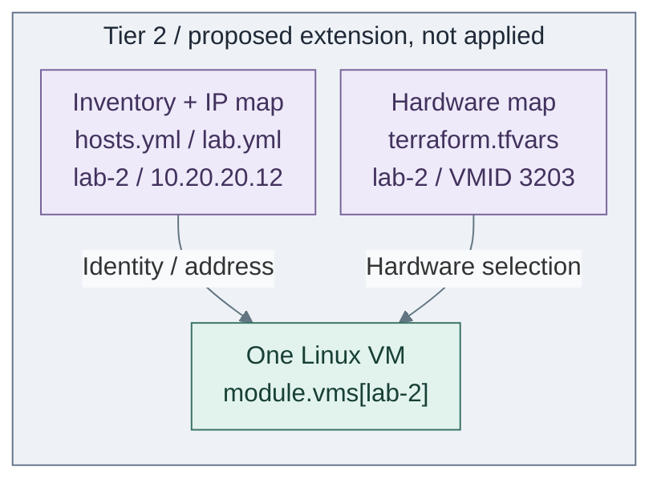

# Add a guest or service

Extend an existing setup when the new guest belongs to its lifecycle. Add a role/recipe
for configuration behavior; create another Terraform root only for an independently managed resource set.

**Working repository:** `<prefix>-tier-2`; source owner `tier-2/`.
**Prerequisites:** configured lab inputs, approved Linux template/storage/node, SSH access and
a permitted network. [Platform inputs](../reference/platform-inputs.md) owns those selections.

To add a VM to the existing lab setup, follow **1–4** below. For an independently managed resource set,
start with [Option B](#option-b-add-an-independent-linux-setup) instead; it does not require creating `lab-2` first.

## Contents

- [Step 1: Initialize the local inputs](#step-1-initialize-the-local-inputs)
- [Step 2: Add the same host key in three files](#step-2-add-the-same-host-key-in-three-files)
- [Step 3: Inspect the extension](#step-3-inspect-the-extension)
- [Step 4: Provision the extension](#step-4-provision-the-extension)
- [Option A: Add service configuration](#option-a-add-service-configuration)
- [Option B: Add an independent Linux setup](#option-b-add-an-independent-linux-setup)
- [Maintain the upstream example](#maintain-the-upstream-example)

## Step 1: Initialize the local inputs

Initialize only this setup from the Tier 2 repository root:

Run from **`<prefix>-tier-2/`**.

```bash
bash scripts/init-local-files.sh --setup lab
```

Existing local files are preserved. This does not make untouched example values deployable.
An enabled `util-1` LXC needs its actual `template_file_id`; a VM-only new project
omits that host/IP and uses `lxc_instances = {}` before its first apply.
Existing managed resources require their original inputs/state.

| Editing purpose | Files to edit |
| --- | --- |
| Existing private project | Initialized `hosts.yml`, `lab.yml`, `terraform.tfvars`; preserve other entries |
| Maintained kit example | Their `.example` counterparts under `tier-2/`; keep live credentials/state outside Git |

The example adds **`lab-2` / VMID `3203`**. Reserve an unused ID under the
[VMID convention](../conventions/vmid-convention.md).
The displayed IP/attachment match the starter's application network; use the actual selected
network and a free address outside DHCP. Unsafe workloads first need the
[isolated lab network](../deployment/stage-10-lab-environments/README.md#step-2a-linux-vmlxc-labs).

## Step 2: Add the same host key in three files

Complete all three edits below; these are required parts of the same guest definition.

<a id="2a-inventory-identity"></a>

### 1. Add the inventory identity

Edit in **`<prefix>-tier-2/`**.

- `ansible/inventory/hosts.yml`: add `lab-2` under `all.children.lab.hosts`; retain existing hosts.

Add this host entry:

```yaml
lab-2: {}
```

<a id="2b-ip-selection"></a>

### 2. Set the IP address

Edit in **`<prefix>-tier-2/`**.

- `ansible/group_vars/lab.yml`: `platform_host_ips`: add lab-2 and its reserved IP

Add this address:

```yaml
lab-2: 10.20.20.12
```

Keep the map's other hosts. Environment-specific lab vars require their complete IP map;
use the [environment contract](../reference/platform-inputs.md#loading-and-overrides).

<a id="2c-hardware-selection"></a>

### 3. Select the hardware

Edit in **`<prefix>-tier-2/`**.

- `terraform/deployments/lab/terraform.tfvars`: `vm_instances`: add the matching lab-2 key

Add this hardware entry:

```hcl
"lab-2" = {
  vm_id            = 3203
  size             = "tiny"
  storage_class    = "local"
  disk_size_gb     = 20
  network_zone_key = "application"
  tags             = ["internal", "ephemeral", "low"]
}
```

The key is identical in all three maps. Template selection and storage/node references
are inherited through the existing [catalog/profile contract](../reference/platform-inputs.md);
`local` is a logical storage class, not necessarily the Proxmox datastore named `local`.



**Code example:** edits to Tier 2's [inventory](../../tier-2/ansible/inventory/hosts.yml.example),
[IP map](../../tier-2/ansible/group_vars/lab.yml.example) and
[hardware map](../../tier-2/terraform/deployments/lab/terraform.tfvars.example)
feed its existing [root](../../tier-2/terraform/deployments/lab/main.tf).
`lab-2` is an extension described here, not a preconfigured starter host.
The [lab recipe](../../tier-2/ansible/playbooks/deployment/lab-vms.yml) applies the baseline only.

## Step 3: Inspect the extension

Run from Tier 2 with the accepted Ansible environment:

Run from **`<prefix>-tier-2/`**.

```bash
ANSIBLE_CONFIG=ansible/ansible.cfg ansible-inventory -i ansible/inventory/hosts.yml --graph lab
ANSIBLE_CONFIG=ansible/ansible.cfg ansible lab-2 -i ansible/inventory/hosts.yml -e @ansible/group_vars/all.yml -e @ansible/group_vars/lab.yml -m ansible.builtin.debug -a var=ansible_host
```

Require `lab-2` in the lab group and the selected IP. The debug action resolves inputs;
it does not test SSH or install anything. [1]
Continue after the inventory contains `lab-2` at the selected address.

## Step 4: Provision the extension

Run from **`<prefix>-tier-2/`**.

```bash
bash scripts/deploy.sh lab
```

Review Terraform's displayed plan: expect the new VM and no unexplained removal/replacement of existing guests.
Enter `yes` to provision it and run the baseline; enter `no` to stop.
For an optional preview, add `--plan-only`; approved unattended CI can use `--auto-approve`.

**Expected:** Terraform creates the selected guest and Ansible completes its baseline without failures.
Adding a guest does not install an application. Continue with **Option A** when service configuration is needed.

## Option A: Add service configuration

1. Reuse an existing role where its contract fits. Edit these files:

   Edit in **`<prefix>-tier-2/`**.

   - `ansible/roles/<service>/tasks/main.yml`: implementation, templates and handlers as needed
   - `ansible/playbooks/deployment/lab-service.yml`: target selected lab hosts; compose accepted roles
   - `ansible/requirements.yml`: add required collections
   - `ansible/playbooks/control-node.yml`: collection catalog and lab precheck mapping:
     `control_node_collection_catalog` and `control_node_setup_collection_names.lab`

   Shared is for reusable stateless behavior consumed by multiple tiers.
   Maintenance recipes reuse roles for supported operations.
2. After implementing/reviewing the role and recipe, run configuration only:

   Run from **`<prefix>-tier-2/`**.

   ```bash
   bash scripts/deploy.sh lab --ansible-only --playbook deployment/lab-service.yml
   ```

This is a project-extension pattern, not a supplied `lab-service` installer.
Another playbook alone does not need another Terraform state.

## Option B: Add an independent Linux setup

Use a new name only when its resources need their own lifecycle/state. In the owning tier:

| File | Required change |
| --- | --- |
| `terraform/deployments/<setup>/` | Compose existing modules; include root `.tf`, reviewed lock and `terraform.tfvars.example`; exclude live `.tfvars`, state and cache |
| `ansible/inventory/hosts.yml.example` | Add unique host keys/group and appropriate `guests` membership |
| `ansible/group_vars/<setup_stem>.yml.example` | Matching IPs/service inputs; replace setup-name dashes with underscores |
| `ansible/playbooks/<setup>.yml` | Import the new deployment recipe with its actual target group |
| `ansible/playbooks/control-node.yml` | Register required collections and dependency declarations |
| `.deployment-setups` | Add the unique setup name to its single owner |

The kit's `scripts/tier-repos/payload.py` → `tier_setups()` derives this list from
`.deployment-setups` and checks required files/roots; see the [generation contract](generated-repositories.md).
There is no second static setup map.
Native Kubernetes applications use recipes/roles rather than unnecessary Linux roots.
A genuinely Terraform-only workflow requires its dedicated command/validation contract.

## Maintain the upstream example

From the **kit root**, review generation without writing a collection:

Run from **upstream kit root**.

```bash
bash scripts/init-tier-repos.sh --dry-run
```

Keep source examples, guide snippets and focused checks aligned. Generated `.example` updates
do not merge hosts into existing private inputs; [refresh ownership](generated-repositories.md#refresh-and-local-ownership)
defines the boundary. Existing VMIDs/state require a separate migration design before changing.

## References

1. [Ansible debug action and connection semantics](https://docs.ansible.com/projects/ansible/latest/collections/ansible/builtin/debug_module.html).
